# OfferGrid prototype: Advertiser workspace inventory

This is an inventory of the advertiser side of the OfferGrid clickable prototype (`offergrid-v4/index.html`). It is written so a team can rebuild the advertiser workspace in Next.js without opening the prototype. The Platform (Global) console and the design system are covered in a separate document. This one covers them only where an advertiser flow crosses into them.

**How it was captured.** The prototype was driven in headless Chromium (Playwright) at 1280×900 and 390×844 on Fri 13 Nov 2026 at about 22:00 GMT. Every screen was opened, every control was clicked, and the text, toasts and native dialogs were recorded. The app's JavaScript is readable source, not minified: lines 159–488 of `index.html`. Line 158 is only a base64 image blob (`const IMG={supa10, metro, jackpot10, pariez}`). Every formula below was confirmed against that source.

**Two caveats that affect every number.**
1. **Seed metrics are random.** Each campaign's impressions, opens and so on are generated at page load with ±15% randomness (see [Object model → seed generator](#seed-generator)). Screenshots and quoted figures are example values, and they differ between screenshots taken in separate sessions. Budgets, rewards, credit limits, invoices, statement lines and notifications are fixed.
2. **Dates are relative to "now".** Campaign dates are `today ± n days`, so on 13 Nov 2026, `d(-6)` = 7 Nov. Invoice due dates are relative too. Statement dates ("3 Nov", "28 Oct", "1 Oct") and the "Since Oct 2026", "1 Dec", "Nov 2026" strings are hard-coded. The greeting depends on the local hour: "Good morning" before 12:00, "Good afternoon" before 18:00, otherwise "Good evening".

All screenshots are in `shots-advertiser/` (57 files, listed in the [screenshot index](#appendix-screenshot-index)). Full-page captures at 1280 show the sticky sidebar's white background ending at 900 px. That is a capture artefact of `position:sticky; height:100vh`, not a design feature.

---

## Contents

0. [Global shell](#0-global-shell-every-screen)
1. [Campaigns (home)](#1-campaigns-home)
2. [Campaign page (report), for every status](#2-campaign-page-report)
3. [New campaign form (and Edit offer)](#3-new-campaign-form-and-edit-offer)
4. [Phoenix preview modal ("See it on Phoenix")](#4-phoenix-preview-modal-see-it-on-phoenix)
5. [Sharing](#5-sharing)
6. [Rewards](#6-rewards)
7. [Billing & credit](#7-billing--credit)
8. [Invoices](#8-invoices)
9. [People](#9-people)
10. [Workspace](#10-workspace)
11. [Notifications (settings page)](#11-notifications-settings-page)
12. [Bell panel](#12-bell-panel)
13. [Search / ⌘K](#13-search--k)
14. [Workspace switcher and what changes per workspace](#14-workspace-switcher-and-what-changes-per-workspace)
15. [Simulate a day](#15-simulate-a-day)
16. [Responsive behaviour at 390 px](#16-responsive-behaviour-at-390-px)
17. [Object model](#object-model)
18. [Flows](#flows)
19. [Recurring components](#recurring-components)
20. [Open questions](#open-questions)
21. [Appendix: screenshot index](#appendix-screenshot-index)

---

## 0. Global shell (every screen)

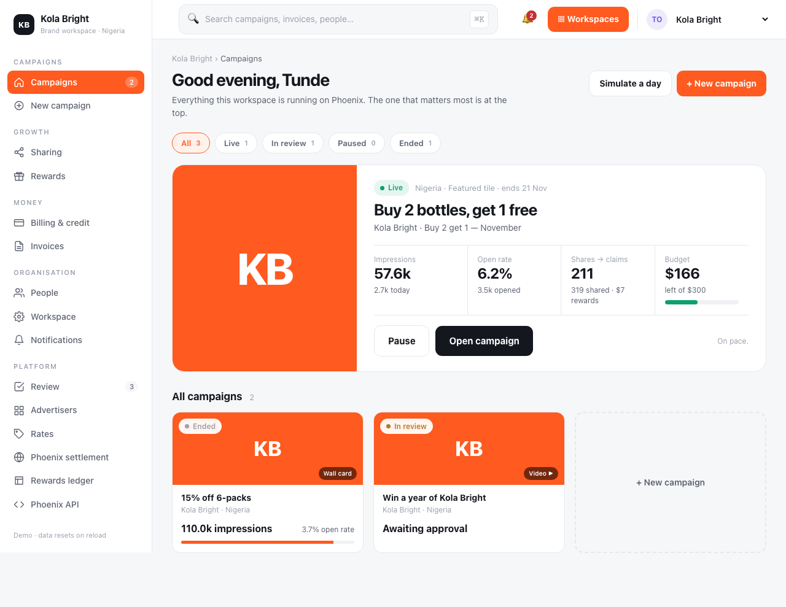

### Layout
- **App grid:** two columns, `Sidebar` (fixed width `--sb`) and `Main`. The sidebar is sticky, full viewport height, scrolls on its own, white with a right border. Main contains `Topbar` (sticky, 64 px), an optional `Banner`, and the page `Wrap` (padding 22 px 32 px 60 px, max-width 1240 px, left-aligned, not centred).
- Page background `#F6F7F9` (`--bg`). Cards are white with a 1 px `#E6E8EE` border and radius `--r`.
- **No URL routing.** Navigation is in-memory (`go(page)`); the URL never changes and there is no back-button support. The window scrolls to the top on every navigation.

### Sidebar
Top to bottom:
1. **Brand block.** A 34×34 rounded logo square on a dark ink background with the workspace initials (white, 800 weight), then the **workspace name** (bold 15 px) and a sub-line `"{Brand|Agency} workspace · {Country}"`.
   - Kola Bright: logo `KB`, "Kola Bright", "Brand workspace · Nigeria"
   - MediaSpec (agency): logo `M(` (the initials function takes the first character of each word, so "(agency)" gives "("; see Open questions), "MediaSpec (agency)", "Agency workspace · Nigeria"
   - Pesa Link: `PL`, "Pesa Link", "Brand workspace · Kenya"
   - SunFresh Juices: `SJ`, "SunFresh Juices", "Brand workspace · Ghana"
   - In Platform mode: logo `OG` on orange, "OfferGrid", "Platform console"
2. **Nav** (`<nav id="nav">`). Group labels are 11 px uppercase, letter-spaced and grey. Each item is a full-width button with an 18 px stroke icon and a label; the current item is orange-filled with white text. A count pill (`.cnt`) is right-aligned.
   - **CAMPAIGNS:** `Campaigns` (house icon; badge = count of this workspace's campaigns with status live, paused, review or scheduled; it also stays highlighted on a campaign page), `New campaign` (plus-in-circle icon).
   - **GROWTH:** `Sharing` (share icon), `Rewards` (gift icon).
   - **MONEY:** `Billing & credit` (card icon), `Invoices` (document icon; badge = number of invoices with status due or overdue, shown only when above 0).
   - **ORGANISATION:** `People`, `Workspace` (cog), `Notifications` (bell).
   - **PLATFORM:** `Review` (badge = campaigns in review across all workspaces + pending workspaces), `Advertisers`, `Rates`, `Phoenix settlement`, `Rewards ledger`, `Phoenix API`. Clicking any Platform item switches the whole app into Platform mode. This group appears in advertiser mode only as a prototype convenience (see Open questions).
   - Badges re-render only when navigating. After inline actions (End campaign now, Mark paid) a badge goes stale until the next nav click.
3. **Footer** (pinned to the bottom, 11 px grey): `Demo · data resets on reload`.

### Topbar
Left to right:
- **Search field** (`Search`): a grey rounded box, centred, max 520 px wide: `🔍 Search campaigns, invoices, people…` with a `⌘K` key-cap at the right. **It is not interactive** (see §13).
- **Bell** (`🔔`, 38×38) with a red count bubble (count = number of notifications in the current workspace; hidden when 0). Opens the Bell panel (§12).
- **`▦ Workspaces`** button: orange, white bold text. Click: focuses the workspace `<select>` and shows the toast `Pick a workspace from the switcher on the right`.
- **Who block** (after a left divider): a 34 px circular avatar (purple tint) with the **initials of the workspace's first member (the Owner)**: `TO` Tunde Okafor, `DA` Dolapo Adeyemi, `WK` Wanjiru Kamau, `KM` Kofi Mensah, `GL` in Platform mode. Next to it is a native `<select aria-label="Workspace">` with options `Kola Bright`, `MediaSpec (agency)`, `Pesa Link`, `SunFresh Juices`, `Platform (Global)`. This select **is** the workspace switcher (§14).

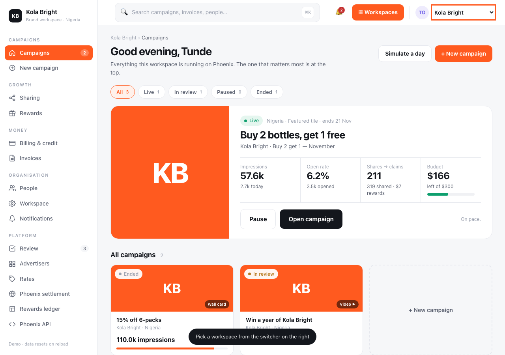

### Banner (between topbar and page)
A full-width strip with a peach background (`#FFF7F3`), a bottom border and 13 px brown text; the first words are bold orange.
- Workspace pending approval (SunFresh): **`Awaiting approval`** ` — Global checks new advertisers within one working day. You can build campaigns now; they go live once the workspace is approved.`
- Platform mode: **`Platform`** ` — you are acting as Global. Approvals, rates and settlements here affect every advertiser.`
- Otherwise hidden.

### Page head (`PageHead`, used by every page)
- **Breadcrumb** (13 px grey). The pattern is `{Workspace name} › {Section} › {Page}`, where the last segment is darker and earlier links are blue. The Campaigns home uses `Kola Bright › Campaigns`; Growth/Money/Organisation pages use `Kola Bright › Growth › Sharing`, and the group word is *not* a link. Campaign pages use `Kola Bright › Campaigns › {campaign name}`, where "Campaigns" is a blue link back to home.
- **H1** (28 px, tight tracking) and a **lead paragraph** (grey, max 62ch).
- **Actions** right-aligned in the head row (button group, wraps).

### Toast
A dark pill fixed at bottom-centre, white 13 px text, fades in, auto-hides after 2.2 s, max-width 90vw. Only one toast exists; a new toast replaces the current one. Every toast string is listed with the action that triggers it.

### Number and date formatting (used everywhere)
| Helper | Rule | Examples |
|---|---|---|
| `fmt` (counts) | ≥1,000,000 → 2 decimals + `M`; ≥1,000 → 1 decimal + `k`; else rounded integer | `57.6k`, `110.0k`, `1.33M`, `317` |
| `usd` | `$` + rounded whole dollars with thousands separators; negatives use the Unicode minus `−` before `$` | `$1,500`, `−$118`, `$0` |
| `loc` (local currency) | currency symbol + rounded (USD × FX) with separators, **no space** | `₦209,250`, `KSh12,384`, `GH₵7,750`, `TSh1,300,000`, `F305,000`, `−₦182,900` |
| `pct` | a÷b × 100, 1 decimal + `%`; `0%` if b = 0 | `6.1%`, `30.0%`, `0%` |
| dates | `en-GB` day + short month | `7 Nov`, `21 Nov` |
| days left (`dl`) | ceil((date − now) ÷ 1 day), floor 0 | `8d left` |

---

## 1. Campaigns (home)

Nav: CAMPAIGNS › Campaigns. This is the landing page and the page every workspace switch lands on.


Above the fold at 1280×900: [home-abovefold-1280.png](shots-advertiser/home-abovefold-1280.png). The fold shows the head, the filter pills, the whole hero card, and the "All campaigns" header plus the top of the first row of cards.

### Layout (top to bottom)
1. **PageHead**
   - Crumb: `Kola Bright › Campaigns`
   - H1: `{Good morning|Good afternoon|Good evening}, {Owner first name}`, e.g. `Good evening, Tunde`, `Good evening, Dolapo`, `Good evening, Wanjiru`, `Good evening, Kofi`
   - Lead: `Everything this workspace is running on Phoenix. The one that matters most is at the top.`
   - Actions: `Simulate a day` (white/bordered button) and `+ New campaign` (orange primary → New campaign form).
2. **Filter pills** (`FilterPills`): `All`, `Live`, `In review`, `Paused`, `Ended`, each followed by a small grey count, e.g. `All 3 · Live 1 · In review 1 · Paused 0 · Ended 1`. The selected pill is outlined orange on a peach background (`aria-pressed="true"`). There are **no pills for Scheduled or Rejected**; those campaigns appear only under `All`. Counts are for the current workspace. The filter value is global, so it persists when switching workspace.
3. **Hero campaign card** (`HeroCampaignCard`), shown only when the filter is `All` and a hero exists (see the selection rule below). A two-column card with radius 20:
   - Left (300 px): the **art** panel. The creative image (`contain`, dark `#0b0f1a` background) or, if there is no image, the campaign colour with the brand initials in 72 px white bold.
   - Right body:
     - Eyebrow: `StatusBadge` + `{Country} · {Placement name} · {ends 21 Nov | starts 16 Nov | awaiting approval}`. Live/paused campaigns show "ends", scheduled campaigns show "starts", in-review campaigns show "awaiting approval".
     - H2 = offer headline (e.g. `Buy 2 bottles, get 1 free`).
     - Sub-line `{Brand} · {Campaign name}` (e.g. `Kola Bright · Buy 2 get 1 — November`).
     - **Stats row** (4 equal columns divided by vertical rules, top and bottom borders):
       | Label | Big value | Sub-line | Computation |
       |---|---|---|---|
       | `Impressions` | `57.6k` | `3.4k today` | total `imp`; sub = `days[13]` (the last element of the 14-day series) |
       | `Open rate` | `6.1%` | `3.5k opened` | `opens ÷ imp` |
       | `Shares → claims` | `209` | `317 shared · $7 rewards` | big = **friend claims via shares** (`sClaims`); sub = shares count and USD rewards paid |
       | `Budget` | `$167` | `left of $300` + green progress bar | `budget − spend` (spend = delivery + rewards paid); bar width = spend ÷ budget |
     - Actions row: `Pause` (large, white/bordered; only if live) **or** `Resume` (large, orange; only if paused), then `Open campaign` (large, dark ink) → campaign page. On the right is a grey 12 px **pace note**:
       - live and pace < 0.8 → `Delivering slower than planned — consider extending the flight.`
       - live and pace > 1.2 → `Delivering faster than planned — budget will finish early.`
       - live otherwise → `On pace.`
       - paused → `Paused — not delivering. Resume any time.`
       - review → `Global reviews within one working day.`
       - scheduled → (empty)
     - **Pace** = (spend ÷ budget) ÷ max(0.05, elapsed fraction of the flight), where elapsed fraction = (now − start) ÷ (end − start). In seed data, "Buy 2 get 1" is about 1.0 (On pace), and Supa10, Foot Gabal-Lena and Pesa Link come out above 1.2 ("faster").
   - **Hero selection rule:** the first campaign in list order (newest submissions are prepended) with status live; if none, the first paused; then the first in review; then the first scheduled; otherwise no hero. Ended and rejected campaigns are never the hero.
4. **Section header** (`SectionHeader`): H3 `All campaigns` (or the filter's name: `Live`, `In review`, `Paused`, `Ended`) plus a grey count of the cards below. With the `All` filter the hero is excluded from the list and from the count.
5. **Card grid** (`CampaignCard`): auto-fill columns with a 250 px minimum (3 per row at 1280). Under `All`, the grid ends with a dashed `+ New campaign` tile (`NewCampaignTile`, min-height 200, turns orange on hover) → New campaign form.
6. **Empty state** (only when the workspace has no campaigns at all; SunFresh): a white box, centred, H3 `Nothing on Phoenix yet` and the line `Create your first offer. It takes about five minutes.` The dashed `+ New campaign` tile still renders above it. A filter with zero matches (e.g. `Paused 0`) shows **only** the header `Paused 0` and an empty grid, with no empty-state copy.

### CampaignCard anatomy
- **Cover** (118 px): the image (cover-fit) or the campaign colour with initials (34 px). Overlays:
  - top-left `StatusBadge` on a white chip
  - top-right `18+` black pill (when the campaign is age-gated)
  - bottom-right placement pill (`Wall card`, `Featured tile`, `Video ▶`, `Splash`; ▶ is appended only for video)
- **Body:** title = headline (bold 14); sub-line `{Brand} · {Country}`, plus ` · {n}d left` for live and paused campaigns. Main row, a bold left value and a small right value:
  - review → `Awaiting approval`
  - scheduled → `Starts 16 Nov`
  - rejected → `Not approved` | `{rejection reason}`
  - otherwise → `{fmt(imp)} impressions` | `{open rate} open rate`
- **Spend bar** (orange, 5 px) for live, paused and ended: spend ÷ budget.
- The whole card is clickable → campaign page. On hover it lifts 2 px and gains a shadow.

### Interactions
| Element | Result |
|---|---|
| Filter pill | Re-renders the list. The hero shows only under `All`; the header becomes the filter name with its count. ([home-filter-review-1280.png](shots-advertiser/home-filter-review-1280.png)) |
| Hero `Pause` | status → paused; toast `Paused — leaves Phoenix within 15 minutes. Resume any time.`; hero re-renders with a `Resume` button and the paused note ([home-hero-paused-1280.png](shots-advertiser/home-hero-paused-1280.png)) |
| Hero `Resume` | If the workspace's credit in use > credit limit: toast `Can't resume — credit limit reached. Pay the open invoice or ask Global to raise the limit.` and nothing changes ([home-resume-blocked-credit-1280.png](shots-advertiser/home-resume-blocked-credit-1280.png)). Otherwise status → live and toast `Resumed — back on Phoenix within 15 minutes.` |
| Hero `Open campaign` / any card | Campaign page |
| `Simulate a day` | See §15 ([home-after-simulate-1280.png](shots-advertiser/home-after-simulate-1280.png)) |
| `+ New campaign` (head button or dashed tile) | New campaign form |

Other states: [home-scheduled-rejected-1280.png](shots-advertiser/home-scheduled-rejected-1280.png) shows cards for Scheduled (`Starts 16 Nov`) and Rejected (`Not approved` + reason). The hero here is a brand-new live campaign with zero delivery, so its note reads "Delivering slower than planned — consider extending the flight."

---

## 2. Campaign page (report)

Reached from any campaign card, the hero's `Open campaign`, a Sharing table row, or straight after submitting or resubmitting. While a campaign page is open, the nav highlights **Campaigns**. One layout serves every status; the differences are listed under [Per-status differences](#per-status-differences).

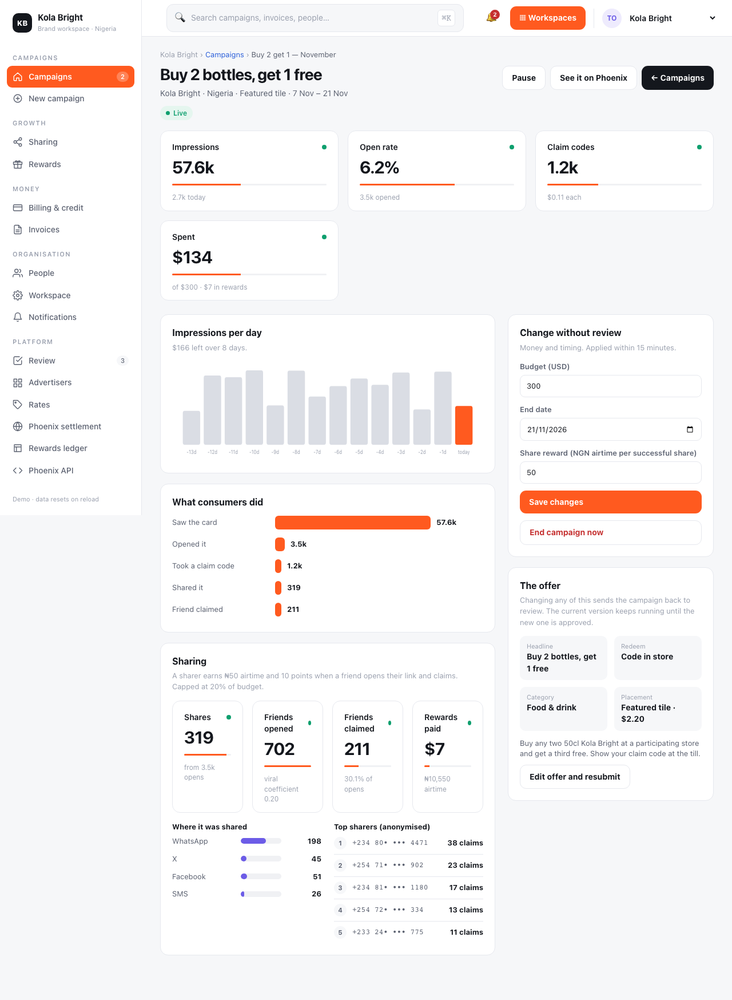

### Layout
1. **PageHead**
   - Crumb: `Kola Bright › Campaigns › Buy 2 get 1 — November` ("Campaigns" is a link to home)
   - H1 = offer headline (`Buy 2 bottles, get 1 free`)
   - Lead = `{Brand} · {Country} · {Placement} · {start} – {end}` (e.g. `Kola Bright · Nigeria · Featured tile · 7 Nov – 21 Nov`)
   - Actions: `Pause` (white; live only) **or** `Resume` (orange; paused only), then `See it on Phoenix` (white → preview modal, §4) and `← Campaigns` (dark → home).
2. **Status line** under the head: `StatusBadge`, then:
   - review: grey `Global usually decides within one working day`
   - rejected: the red rejection reason (e.g. `Terms unclear — say where the offer can be redeemed.`)
3. **KPI row** (`MetricCard` ×4, auto-fill grid with a 240 px minimum, so it wraps 3 + 1 at 1280). Each `MetricCard` has a title, a green dot, a big value, a thin orange progress line and a grey sub-line.
   | Title | Value | Sub-line | Progress line |
   |---|---|---|---|
   | `Impressions` | `fmt(imp)` | `{fmt(days[13])} today` | spend ÷ budget |
   | `Open rate` | `opens ÷ imp` | `{fmt(opens)} opened` | open rate ÷ 10% (10% = full) |
   | `Claim codes` (redeem = code) / `Clicks to you` (redeem = link) | `fmt(claims)` | `${spend ÷ claims, 2 decimals} each` (cost per claim/click, **total spend including rewards**), or `—` when 0 | claims ÷ opens |
   | `Spent` | `usd(spend)` | `of {usd(budget)} · {usd(rewardPaid)} in rewards` | spend ÷ budget |
4. **Two-column body** (left fluid, right 360 px):
   - **Left**
     - Box **`Impressions per day`**:
       - Sub-line: live → `{usd(left)} left over {days left} days.` (e.g. `$167 left over 8 days.`); paused → `Paused — not delivering.`; review → `Starts once approved.`; ended → `Finished.`; scheduled **and rejected** → `Scheduled.`
       - `BarChart14d`: an SVG bar chart (700×170 viewBox, stretched) with 14 bars labelled `-13d` … `-1d`, `today`. Past bars are light grey (`#DADDE4`); today's bar is orange. Each bar has an SVG `<title>` tooltip with the `fmt` value. No axes or gridlines.
     - Box **`What consumers did`** (`Funnel`): five rows of label, orange bar, bold value. Bar width = max(2%, value ÷ impressions × 50%).
       - `Saw the card` = imp
       - `Opened it` = opens
       - `Took a claim code` (code) / `Clicked to your site` (link) = claims
       - `Shared it` = shares
       - `Friend claimed` = sClaims
     - Box **`Sharing`**:
       - Sub: `A sharer earns {local symbol}{reward} airtime and 10 points when a friend opens their link and claims. Capped at {rewardCap}% of budget.` For example `A sharer earns ₦50 airtime and 10 points …`, `KSh10`, `F100`, `TSh500`, `KSh5`. The amount is the local reward with thousands separators and no space after the symbol.
       - A 4-column grid of `MetricCard`s (inline `repeat(4,1fr)`):
         - `Shares`: value = shares; sub `from {fmt(opens)} opens`; bar = shares ÷ opens ÷ 10%
         - `Friends opened`: value = sOpens; sub `viral coefficient {sOpens ÷ opens, 2 dp}`; bar = min(100, sOpens ÷ shares × 50)
         - `Friends claimed`: value = sClaims; sub `{pct(sClaims, sOpens)} of opens`
         - `Rewards paid`: value = usd(rewardPaid); sub `{loc(rewardPaid)} airtime` (e.g. `₦10,450 airtime`); bar = rewardPaid ÷ (budget × cap%)
       - Two sub-columns:
         - **`Where it was shared`** (`HBarList`, purple bars): rows in fixed order `WhatsApp`, `X`, `Facebook`, `SMS`, each with its absolute count; bar = count ÷ shares.
         - **`Top sharers (anonymised)`** (`Leaderboard`): five rows of rank circle, masked phone in monospace (`+234 80• ••• 4471`, `+254 71• ••• 902`, `+234 81• ••• 1180`, `+254 72• ••• 334`, `+233 24• ••• 775`) and `{n} claims`. The claims are 18% / 11% / 8% / 6% / 5% of sClaims. With no data it shows `No shares yet.`
   - **Right**
     - Box **`Change without review`** (`EditPanel`), sub `Money and timing. Applied within 15 minutes.`:
       - `Budget (USD)`: number, `min` = ceil(spend), step 10, prefilled.
       - `End date`: date input, prefilled.
       - `Share reward ({CUR} airtime per successful share)`: e.g. `Share reward (NGN airtime per successful share)`; number, min 0, step 5.
       - `Save changes` (orange, full width; **disabled** when ended or rejected).
       - `End campaign now` (white with red text; **only** when live or paused).
     - Box **`The offer`**, sub `Changing any of this sends the campaign back to review. The current version keeps running until the new one is approved.`:
       - 2×2 `KVGrid` of grey tiles with a small label and bold value: `Headline` | `Redeem` (`Code in store` / `Link`) | `Category` | `Placement` (`Featured tile · $2.20`, i.e. placement + current CPM for that country).
       - The description paragraph.
       - Button `Edit offer and resubmit` (white) → the form in Edit mode (§3).

### Interactions
| Element | Result |
|---|---|
| `Pause` / `Resume` | Same as the hero (same toasts, same credit check); the page re-renders with the new status ([campaign-paused-1280.png](shots-advertiser/campaign-paused-1280.png)) |
| `See it on Phoenix` | Opens the preview modal for this campaign (§4) |
| `← Campaigns`, crumb `Campaigns` | Home |
| `Save changes` | Budget < spend → toast `Budget can't be below what's already spent`. Budget increase that pushes credit in use over the limit → toast `That would exceed your credit limit of $1,500` (the workspace's limit). Otherwise budget, end date and reward are applied; toast `Saved — live within 15 minutes, no review needed`; page re-renders (e.g. `$218 left over 8 days.`; the sharing sentence shows the new reward). The end date is not validated (it can be before the start). Changing the end date also changes the days left and the pace. |
| `End campaign now` | Native `confirm("End now? Unspent budget is released from your credit.")`. Cancel → nothing. OK → status ended; toast `Ended — {usd(budget − spend)} released` (e.g. `Ended — $218 released`). Pause/Resume and End disappear and `Save changes` is disabled ([campaign-ended-by-advertiser-1280.png](shots-advertiser/campaign-ended-by-advertiser-1280.png)). |
| `Edit offer and resubmit` | Opens the New campaign form prefilled, in Edit mode (§3) |

### Per-status differences
| Status | Badge (colour) | Head actions | Status-line extra | Chart sub | Save changes | End now | Seen at |
|---|---|---|---|---|---|---|---|
| Live | `Live` (green) | Pause, See it on Phoenix, ← Campaigns | none | `$X left over N days.` | enabled | shown | [campaign-live-1280](shots-advertiser/campaign-live-1280.png), [with image & 18+](shots-advertiser/campaign-live-image-18plus-1280.png) |
| Paused | `Paused` (amber) | **Resume** (orange), See it on Phoenix, ← Campaigns | none | `Paused — not delivering.` | enabled | shown | [campaign-paused-1280](shots-advertiser/campaign-paused-1280.png) |
| In review | `In review` (amber) | See it on Phoenix, ← Campaigns | `Global usually decides within one working day` | `Starts once approved.` | enabled | hidden | [campaign-in-review-1280](shots-advertiser/campaign-in-review-1280.png), [splash](shots-advertiser/campaign-in-review-splash-1280.png), [just submitted](shots-advertiser/campaign-submitted-in-review-1280.png) |
| Scheduled | `Scheduled` (blue) | See it on Phoenix, ← Campaigns | none | `Scheduled.` | enabled | hidden | [campaign-scheduled-1280](shots-advertiser/campaign-scheduled-1280.png) |
| Rejected | `Rejected` (red) | See it on Phoenix, ← Campaigns | red reason text | `Scheduled.` (prototype bug) | **disabled** | hidden | [campaign-rejected-1280](shots-advertiser/campaign-rejected-1280.png) |
| Ended | `Ended` (grey) | See it on Phoenix, ← Campaigns | none | `Finished.` | **disabled** | hidden | [campaign-ended-1280](shots-advertiser/campaign-ended-1280.png) |

A campaign that has never delivered (in review, scheduled, rejected, or newly submitted) shows zeros everywhere: `0`, `0 today`, `0%`, `0 opened`, `—` for cost-per-claim, a flat chart, the funnel at 2% width, `viral coefficient 0.00`, `0% of opens`, `$0`, `₦0 airtime`, channel counts of 0, and `No shares yet.`

---

## 3. New campaign form (and Edit offer)

Nav: CAMPAIGNS › New campaign. **This is a single page, not a multi-step wizard**; the lead says so: "One form." There are no steps, no back/next and no save-draft. Validation is live: the submit button stays disabled and a single hint shows the **first** failing rule.

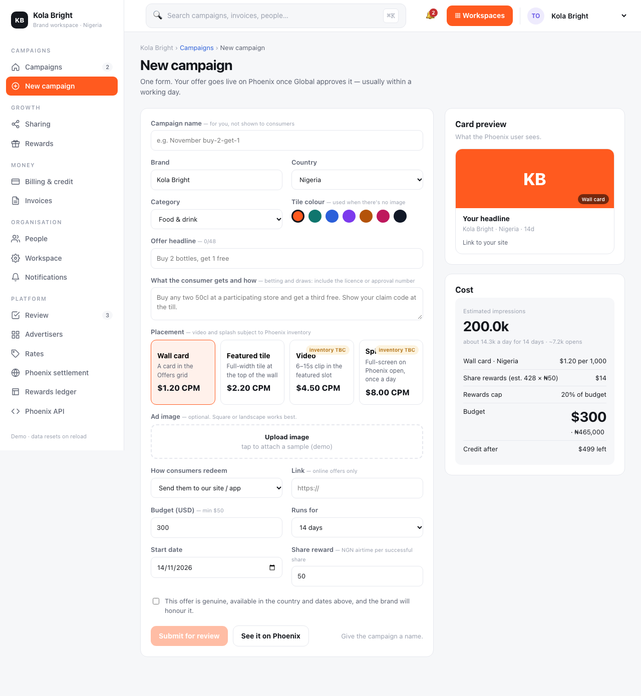

States captured:
- [filled and valid](shots-advertiser/new-filled-valid-1280.png)
- [betting licence error](shots-advertiser/new-error-licence-1280.png)
- [video needs creative](shots-advertiser/new-video-needs-creative-1280.png)
- [splash with creative attached](shots-advertiser/new-splash-creative-1280.png)
- [agency (MediaSpec)](shots-advertiser/new-agency-mediaspec-1280.png)
- [pending workspace (SunFresh)](shots-advertiser/new-sunfresh-pending-1280.png)
- [Edit offer](shots-advertiser/new-edit-offer-1280.png)
- [390](shots-advertiser/new-empty-390.png)

### PageHead
- Crumb `Kola Bright › Campaigns › New campaign` (`Campaigns` is a link)
- H1 `New campaign`
- Lead `One form. Your offer goes live on Phoenix once Global approves it — usually within a working day.`
- No head actions.

### Layout
Two columns: left is the form box (a 2-column form grid); right (360 px) holds the **Card preview** box and the **Cost** box. Each label is 13 px semibold grey with an optional lighter `<small>` hint after an em dash.

### Fields (in order; "full" = spans both form columns)
| # | Label (verbatim) | Hint | Control | Default / behaviour |
|---|---|---|---|---|
| 1 | `Campaign name` (full) | `— for you, not shown to consumers` | text, placeholder `e.g. November buy-2-get-1` | empty |
| 2 | `Brand` | agency workspace only: `— client` | text | Brand workspace: **readonly**, prefilled with the workspace name. Agency: empty and editable. |
| 3 | `Country` | none | select: `Nigeria`, `Kenya`, `Ghana`, `Tanzania`, `Senegal` | the workspace's country. Changing it updates all CPMs, the reward currency label, the preview and the cost. |
| 4 | `Category` | none | select: `Food & drink`, `Personal care`, `Banking & fintech`, `Telecom & data`, `Betting`, `Travel`, `Retail` | `Food & drink` |
| 5 | `Tile colour` | `— used when there's no image` | 7 circular swatch buttons (`aria-label="colour"`, `aria-pressed`): `#FF5A1F`, `#0F766E`, `#2B5FD9`, `#7C3AED`, `#B45309`, `#BE185D`, `#111827` | first (orange); the selected swatch has a dark ring. Updates the preview cover. |
| 6 | `Offer headline` (full) | live counter `— {n}/48` | text, `maxlength=48`, placeholder `Buy 2 bottles, get 1 free` | empty |
| 7 | `What the consumer gets and how` (full) | `— betting and draws: include the licence or approval number` | textarea, `maxlength=240` (no counter), placeholder `Buy any two 50cl at a participating store and get a third free. Show your claim code at the till.` | empty |
| 8 | `Placement` (full) | `— video and splash subject to Phoenix inventory` | 4 `OptionTile`s in a 4-column grid; each has a bold name, a description and a big `$X.XX CPM` for the selected country. Video and Splash carry an amber `inventory TBC` corner badge. | `Wall card` |
| 9 | Media drop zone (full) | label and hint depend on placement (below) | dashed `DropZone` | empty |
| 10 | `How consumers redeem` | none | select: `Claim code shown in store` (code), `Send them to our site / app` (link) | **link** for a new campaign |
| 11 | `Link` | `— online offers only` | text, placeholder `https://` | **disabled** when redeem = code |
| 12 | `Budget (USD)` | `— min $50` | number, min 50, step 10 | `300` |
| 13 | `Runs for` | none | select `7 days`, `14 days`, `30 days` | `14 days` |
| 14 | `Start date` | none | date | tomorrow (`2026-11-14`) |
| 15 | `Share reward` | `— {CUR} airtime per successful share` (e.g. `— NGN airtime per successful share`, `— KES …`, `— GHS …`, `— TZS …`, `— XOF …`) | number, min 0, step 5 | `50` (local currency units) |
| 16 | checkbox (full) | none | `This offer is genuine, available in the country and dates above, and the brand will honour it.` | unchecked |
| 17 | button row (full) | none | `Submit for review` (orange primary), `See it on Phoenix` (white), and in Edit mode `Cancel`. The right-aligned grey **hint** shows the current validation message. | Submit is disabled while any rule fails |

**Placement option tiles** (names, descriptions and CPM for Nigeria; other countries in the [rates table](#markets-currencies-and-rates)):

| key | Name | Description | NG CPM |
|---|---|---|---|
| card | `Wall card` | `A card in the Offers grid` | `$1.20 CPM` |
| featured | `Featured tile` | `Full-width tile at the top of the wall` | `$2.20 CPM` |
| video | `Video` + `inventory TBC` | `6–15s clip in the featured slot` | `$4.50 CPM` |
| splash | `Splash` + `inventory TBC` | `Full-screen on Phoenix open, once a day` | `$8.00 CPM` |

**Media drop zone** (label + hint, then the zone's text):
- Wall card / Featured tile: `Ad image` `— optional. Square or landscape works best.`, zone **`Upload image`** / `tap to attach a sample (demo)`
- Video: `Video clip` `— MP4, 6–15 s, under 2 MB. Required.`, zone **`Upload creative`** / `tap to attach a sample (demo)`
- Splash: `Splash creative` `— portrait image or video, under 2 MB. Required.`, same zone text
- When attached, the zone shows a thumbnail (max 90 px tall) and `Tap to remove`. In the prototype a click attaches a random sample from the four bundled images, and clicking again removes it. There is no file picker and no real video.

### Live validation (rules in this order; the hint shows the first failure verbatim)
1. Name empty → `Give the campaign a name.`
2. Brand empty (agency only, in practice) → `Which brand is this for?`
3. Headline empty → `Write the offer headline.`
4. Description empty → `Describe what the consumer gets.`
5. (Category = Betting **or** headline matches /draw|jackpot/i) **and** the description lacks /licen|approv|NLRC|BCLB|LONASE|GBT/i → `Betting and draw offers need a licence or approval number in the description.`
6. Redeem = link and the link does not start with `https://` (so `http://` fails) → `Online offers need an https:// link.`
7. Placement video or splash with no creative → `Video and splash need a creative attached.`
8. Budget < 50 (or empty) → `Minimum budget is $50.`
9. Credit in use + this budget (Edit: + the budget increase) > credit limit → `Over your credit limit of {usd(limit)} by {usd(excess)}. Pay an open invoice or ask Global to raise it.` (e.g. `Over your credit limit of $1,500 by $1,202. Pay an open invoice or ask Global to raise it.`). Pesa Link fails this with the default $300 budget (available $127).
10. Terms unchecked → `Confirm the offer is genuine.`
11. All pass → the hint is empty and `Submit for review` is enabled.

Because the button is disabled, "submitting empty" is impossible. On first load the hint reads `Give the campaign a name.` and the button is disabled.

### Card preview box
Title `Card preview`, sub `What the Phoenix user sees.` The body is a `CampaignCard` built from the form values (no hover):
- **Cover:** the attached image or the tile colour with brand initials (`?` if the brand is empty).
- **`18+` badge** if category = Betting or the headline matches /jackpot|bet/i. This age rule is **different from** the licence rule, which also matches "draw".
- **Placement pill:** `Wall card` / `Featured tile` / `Video ▶` / `Splash ▶`.
- **Title:** the headline, or `Your headline`.
- **Sub-line:** `{brand or "Brand"} · {Country} · {days}d`.
- **Bottom line:** `Claim code in store` or `Link to your site`.

### Cost box (`EstimatePanel`)
Title `Cost`. A grey panel:

```
Estimated impressions
{fmt(imps)}                                   ← big, e.g. 200.0k
about {fmt(imps ÷ days)} a day for {days} days · ~{fmt(opens)} opens
───────────────────────────────────────────────
{Placement} · {Country}                     ${CPM} per 1,000
Share rewards (est. {fmt(sc)} × {sym}{reward})        {usd(rew)}
Rewards cap                                     20% of budget
Budget                         {usd(budget)} · {loc(budget)}   ← bold USD, e.g. "$300 · ₦465,000"
Credit after                                  {usd(...)} left  ← can go negative: "−$1,202 left"
```

Formulas:
- cap = budget × 0.20
- **imps = (budget − cap) ÷ CPM × 1000**
- opens = imps × open rate for the placement (card 3.6%, featured 5.5%, video 7%, splash 9%)
- sc (estimated successful shares) = opens × 0.09 × 2.2 × 0.3
- rew = min(cap, sc × reward ÷ FX)
- Credit after = limit − credit in use − budget (Edit mode: − the budget increase)

Example defaults for Kola Bright (NG, Wall card, $300, 14 days, ₦50): `200.0k`, `about 14.3k a day for 14 days · ~7.2k opens`, `$1.20 per 1,000`, `Share rewards (est. 428 × ₦50)` `$14`, `$300 · ₦465,000`, `$498 left`.

### Submit
`Submit for review` creates the campaign with status **review**, prepends it to the workspace list, adds the notification `{name} is in review` / `Global usually decides within one working day` / `now` (the bell count goes up by 1), shows the toast `Submitted — Global reviews within one working day`, and navigates to the new campaign's page (In review state).
- End date = start + "Runs for" days.
- The age flag uses the 18+ rule above.
- `video` = (placement = video).

### `See it on Phoenix` (form)
Opens the preview modal (§4) with the draft card ([preview-modal-from-form-1280.png](shots-advertiser/preview-modal-from-form-1280.png)).

### Edit offer mode
Entered from the campaign page's `Edit offer and resubmit`. The same form, prefilled with **all** of the campaign's fields: name, brand, country, category, colour, headline, description, placement, image, redeem, link, budget, start date and reward.
- `Runs for` is preselected only if the flight is exactly 7, 14 or 30 days. Otherwise the browser falls back to `7 days`.
- The terms box starts unchecked again.

Differences from create mode:
- Crumb `… › Campaigns › Edit offer`; H1 `Edit offer`; lead `Saving sends it back to review. The current version keeps running meanwhile.`
- Primary button `Save and resubmit`, plus a third button `Cancel`, which returns to the campaign page.
- The credit rule and "Credit after" count only the budget *increase*.
- Save: overwrites the campaign, sets **status = review** (including a live campaign; see Open questions), shows the toast `Resubmitted — Global reviews within one working day`, and goes to the campaign page.
- The seeded "December draw teaser" is a video with no creative attached, so it cannot be resubmitted until a creative is attached (hint `Video and splash need a creative attached.`).

---

## 4. Phoenix preview modal ("See it on Phoenix")

Opened from the campaign page head or the form. It is a centred white dialog (radius 18, max 760 px wide / 94vw, max 92vh, scrolls) over a 50% dark backdrop.

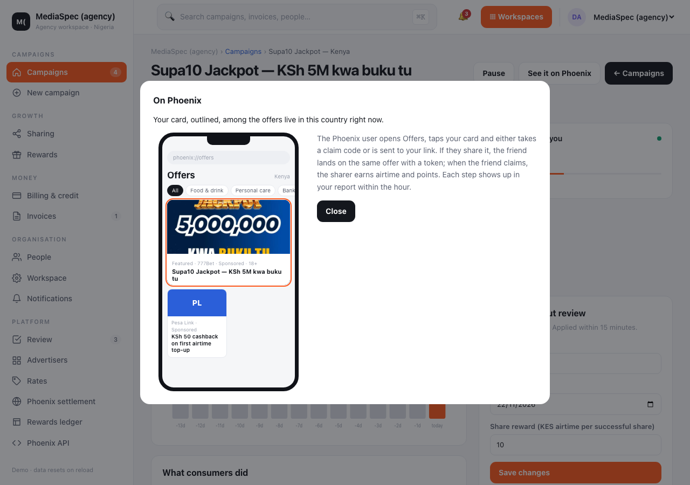
Also captured: [no-image campaign](shots-advertiser/preview-modal-campaign-1280.png), [from the form](shots-advertiser/preview-modal-from-form-1280.png), [390](shots-advertiser/preview-modal-390.png).

- H3 `On Phoenix`; sub `Your card, outlined, among the offers live in this country right now.`
- A two-column `prev` grid: left is a **phone mock** (260×480, 7 px black bezel, radius 28, notch); right is the explanation.
- **Phone screen content (Phoenix Offers wall, top to bottom):**
  1. URL pill `phoenix://offers`
  2. Header `Offers` (bold 17) with the country name right-aligned (e.g. `Nigeria`, `Kenya`)
  3. Category chips: `All` (active, dark) then the first three categories `Food & drink`, `Personal care`, `Banking & fintech` (static)
  4. **Featured slot:**
     - If the previewed campaign's placement is Featured tile, Video or Splash, the campaign itself fills the slot, outlined orange.
     - Otherwise the first *other* live campaign in the same country with a featured or video placement fills it, if any.
     - The slot shows the image (max 100 px tall) or a 70 px colour block with initials, then a caption: small `{Featured|Splash} · {Brand} · Sponsored[ · 18+]` and the bold headline. A splash is shown as this tile, not full-screen, and video shows no player.
  5. **2-column grid of wall tiles**: the previewed campaign (if not featured) plus up to five other live campaigns in the same country. Each tile has a 50 px cover (image or colour with initials), `{Brand} · Sponsored` and the headline (or `Your headline`). The previewed campaign's tile is outlined orange (`pc.mine`).
- **Right column copy:** `The Phoenix user opens Offers, taps your card and either takes a claim code or is sent to your link. If they share it, the friend lands on the same offer with a token; when the friend claims, the sharer earns airtime and points. Each step shows up in your report within the hour.` Then a `Close` button (dark).
- **Close:** the `Close` button or a click on the backdrop. **Escape does nothing**, and there is no focus trap.

---

## 5. Sharing

Nav: GROWTH › Sharing.

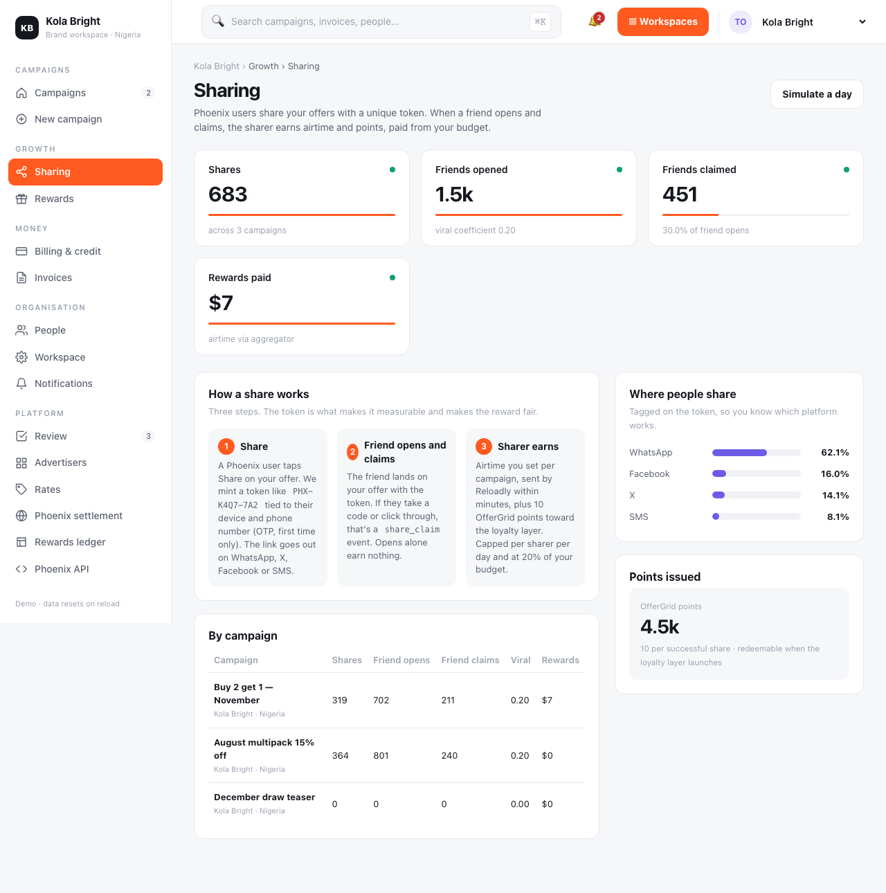

- **PageHead**
  - Crumb `Kola Bright › Growth › Sharing`; H1 `Sharing`
  - Lead `Phoenix users share your offers with a unique token. When a friend opens and claims, the sharer earns airtime and points, paid from your budget.`
  - Action `Simulate a day` (§15; stays on Sharing).
- **KPI row** (4 `MetricCard`s; totals over **all** of this workspace's campaigns, including ended):
  - `Shares` = Σ shares; sub `across {n} campaigns`
  - `Friends opened` = Σ sOpens; sub `viral coefficient {Σ sOpens ÷ Σ opens}`
  - `Friends claimed` = Σ sClaims; sub `{pct} of friend opens`
  - `Rewards paid` = Σ rewardPaid (USD); sub `airtime via aggregator`
- **Left column**
  - Box **`How a share works`**, sub `Three steps. The token is what makes it measurable and makes the reward fair.` Three numbered grey step tiles (`Steps`), each with an orange number circle and a bold title:
    1. **Share**: `A Phoenix user taps Share on your offer. We mint a token like PHX-K4Q7-7A2 tied to their device and phone number (OTP, first time only). The link goes out on WhatsApp, X, Facebook or SMS.` (`PHX-K4Q7-7A2` is styled as a monospace token chip)
    2. **Friend opens and claims**: `The friend lands on your offer with the token. If they take a code or click through, that's a share_claim event. Opens alone earn nothing.` (`share_claim` is a token chip)
    3. **Sharer earns**: `Airtime you set per campaign, sent by Reloadly within minutes, plus 10 OfferGrid points toward the loyalty layer. Capped per sharer per day and at 20% of your budget.`
  - Box **`By campaign`**: a table with columns `Campaign | Shares | Friend opens | Friend claims | Viral | Rewards`.
    - Campaign cell: bold name plus a small grey `{Brand} · {Country}`.
    - Viral = sOpens ÷ opens (2 dp).
    - Rewards = USD.
    - One row per campaign of any status. **Rows are clickable** and open that campaign's page. Hover tints the row.
    - With no campaigns the table has only its header (no empty-state copy).
- **Right column**
  - Box **`Where people share`**, sub `Tagged on the token, so you know which platform works.` `HBarList` of WhatsApp / Facebook / X / SMS **sorted by share descending**, showing a **percentage** (e.g. `WhatsApp 62.1%`, `Facebook 16.1%`, `X 13.9%`, `SMS 8.0%`). Empty when there are no campaigns.
  - Box **`Points issued`**: an `EstimatePanel`-style tile with small `OfferGrid points`, a big `fmt(Σ sClaims × 10)` (e.g. `4.5k`) and the line `10 per successful share · redeemable when the loyalty layer launches`.

Seed data makes "viral coefficient" always come out at about `0.20`, because the generator uses shares = 9% of opens and friend opens = 2.2 × shares.

---

## 6. Rewards

Nav: GROWTH › Rewards.

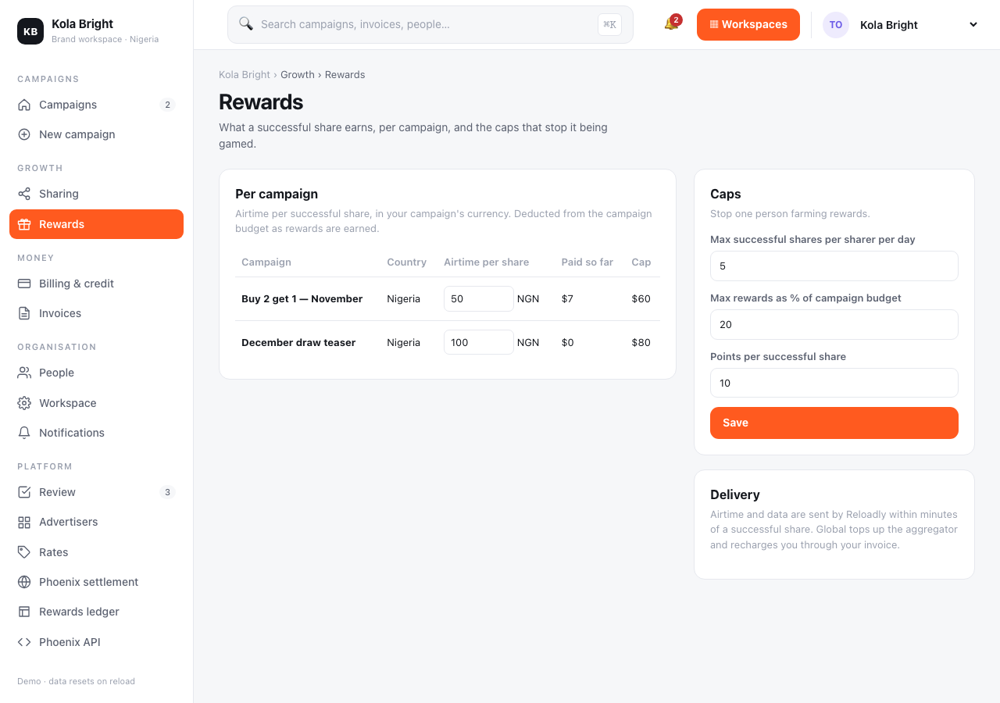

- **PageHead:** crumb `Kola Bright › Growth › Rewards`; H1 `Rewards`; lead `What a successful share earns, per campaign, and the caps that stop it being gamed.` No actions.
- **Left box `Per campaign`**, sub `Airtime per successful share, in your campaign's currency. Deducted from the campaign budget as rewards are earned.` A table with columns `Campaign | Country | Airtime per share | Paid so far | Cap`:
  - Campaign: bold name.
  - Airtime per share: an inline **number input** (90 px, min 0, step 5) holding the reward, followed by the campaign currency code (`NGN`, `KES`, `XOF`, `TZS`).
  - Paid so far = usd(rewardPaid).
  - Cap = usd(budget × 20%).
  - **Only campaigns that are not ended or rejected** are listed.
  - Changing an input (on change) → updates that campaign's reward and shows the toast `Reward updated — applies to new shares`. The campaign page's sharing sentence and edit panel reflect the new value.
- **Right box `Caps`**, sub `Stop one person farming rewards.`:
  - `Max successful shares per sharer per day` = `5`
  - `Max rewards as % of campaign budget` = `20`
  - `Points per successful share` = `10`
  - `Save` (orange) → toast `Caps saved`.
  - **Not persisted, and not wired to any calculation.** Navigating away resets them to 5/20/10, and each campaign's rewardCap stays 20.
- **Right box `Delivery`**: `Airtime and data are sent by Reloadly within minutes of a successful share. Global tops up the aggregator and recharges you through your invoice.`

How rewards are earned and paid, as the prototype models it:
- A reward is earned only when a friend who opened via a share token then **claims** (takes a code or clicks through). Opens alone earn nothing.
- The sharer gets `reward` units of the **campaign country's** currency as airtime, plus 10 OfferGrid points.
- USD cost = reward ÷ FX. It is deducted from the campaign budget (it counts in `spend`), capped at 20% of the budget, and appears as a separate `— share rewards` line on the statement.

---

## 7. Billing & credit

Nav: MONEY › Billing & credit.

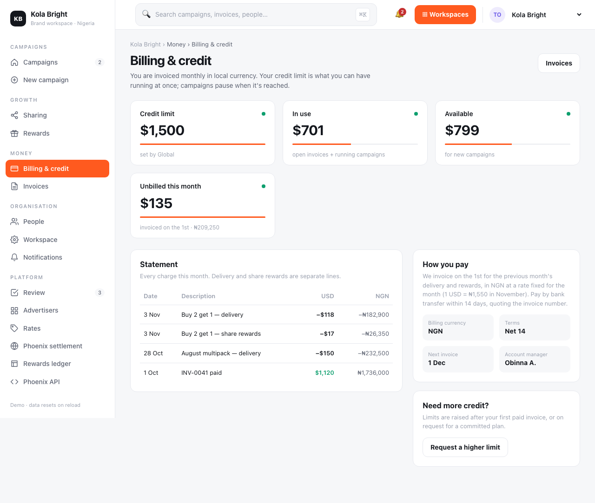
Also: [Pesa Link](shots-advertiser/billing-pesa-1280.png), [SunFresh (empty)](shots-advertiser/billing-sunfresh-empty-1280.png), [credit limit reached](shots-advertiser/billing-credit-limit-reached-1280.png), [390](shots-advertiser/billing-kola-390.png).

- **PageHead:** crumb `Kola Bright › Money › Billing & credit`; H1 `Billing & credit`; lead `You are invoiced monthly in local currency. Your credit limit is what you can have running at once; campaigns pause when it's reached.` Action: `Invoices` (white) → Invoices page.
- **KPI row** (4 `MetricCard`s):
  | Title | Value | Sub-line | Bar |
  |---|---|---|---|
  | `Credit limit` | usd(limit), e.g. `$1,500` | `set by Global` | 100% |
  | `In use` | usd(creditUsed), e.g. `$702` | `open invoices + running campaigns` | used ÷ limit |
  | `Available` | usd(max(0, limit − used)), e.g. `$798` | `for new campaigns`, or `close to the limit` when used > 85% of the limit | available ÷ limit |
  | `Unbilled this month` | usd(unbilled), e.g. `$135` | `invoiced on the 1st · {loc(unbilled)}`, e.g. `invoiced on the 1st · ₦209,250` | 100% |
  - **creditUsed** = outstanding invoices (sum of invoices with status due or overdue) + unbilled + Σ (budget − spend) over this workspace's campaigns with status live, review, scheduled or paused. Ended and rejected campaigns release their remainder.
  - **unbilled** = the sum of negative statement rows whose date contains "Nov", i.e. charges this month.
  - Seed values: Kola ≈ $702 of $1,500; MediaSpec ≈ $5,935 of $8,000; Pesa ≈ $372 of $500; SunFresh $0 of $500.
- **Alert** (`AlertBox`, only when used > limit): a red-bordered pink box. **`Credit limit reached.`** (bold red) followed by ` Live campaigns pause until an invoice is paid or Global raises the limit.`
- **Left box `Statement`**, sub `Every charge this month. Delivery and share rewards are separate lines.` A table with columns `Date | Description | USD | {CUR}` (USD and local columns right-aligned):
  - Charges are negative and shown in ink, bold USD (e.g. `−$118`). Payments are positive and **green** (e.g. `$1,120`). The local column is grey (`−₦182,900`).
  - Rows are newest first; payment rows read `INV-0041 paid`. Delivery and rewards lines are named `{campaign} — delivery` / `{campaign} — share rewards`.
  - Kola seed rows: `3 Nov | Buy 2 get 1 — delivery | −$118 | −₦182,900`; `3 Nov | Buy 2 get 1 — share rewards | −$17 | −₦26,350`; `28 Oct | August multipack — delivery | −$150 | −₦232,500`; `1 Oct | INV-0041 paid | $1,120 | ₦1,736,000`.
  - Empty: one row `No charges yet.`
  - "Simulate a day" and "Mark paid" add rows at the top, dated today (e.g. `13 Nov`).
- **Right box `How you pay`**:
  - Sub `We invoice on the 1st for the previous month's delivery and rewards, in {CUR} at a rate fixed for the month (1 USD = {sym}{FX} in November). Pay by bank transfer within 14 days, quoting the invoice number.` For example `… in NGN … (1 USD = ₦1,550 in November) …`, `KES … KSh129`, `GHS … GH₵15.5`.
  - `KVGrid`: `Billing currency` `NGN` | `Terms` `Net 14` | `Next invoice` `1 Dec` | `Account manager` `Obinna A.`
- **Right box `Need more credit?`**, sub `Limits are raised after your first paid invoice, or on request for a committed plan.` Button `Request a higher limit` (white) → toast `Request sent to Global — usually answered within a working day` (no state change).

**Not present:** there is no "Add funds", no payment methods, no card, no top-up and no wallet. The model is post-paid credit with bank transfer against monthly invoices.

---

## 8. Invoices

Nav: MONEY › Invoices.

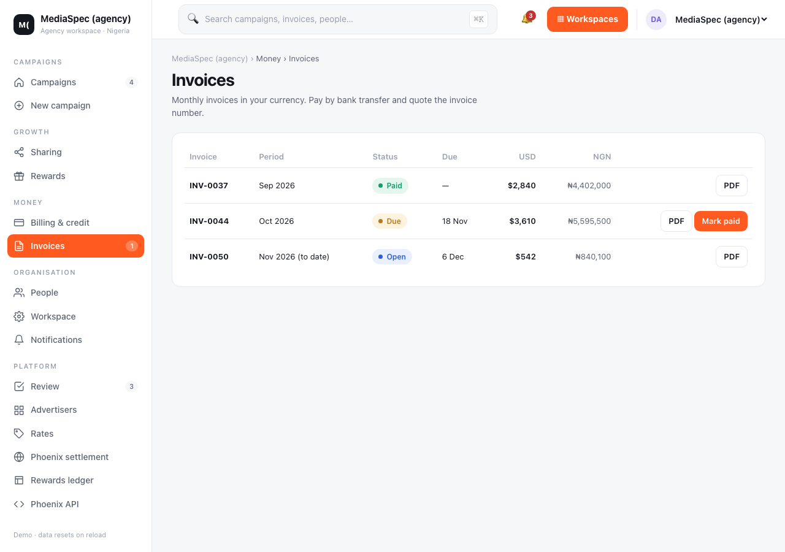
Also: [Kola](shots-advertiser/invoices-kola-1280.png), [Pesa (Overdue)](shots-advertiser/invoices-pesa-overdue-1280.png), [after Mark paid](shots-advertiser/invoices-after-mark-paid-1280.png).

- **PageHead:** crumb `Kola Bright › Money › Invoices`; H1 `Invoices`; lead `Monthly invoices in your currency. Pay by bank transfer and quote the invoice number.` No actions.
- One box with a table: `Invoice | Period | Status | Due | USD | {CUR} | (actions)`.
  - Invoice: bold number, e.g. `INV-0041`.
  - Period: e.g. `Oct 2026`, `Nov 2026 (to date)`.
  - Status: `StatusBadge`: `Paid` (green), `Due` (amber), `Overdue` (red), `Open` (blue; internal status "issued").
  - Due: `—` when paid, else a date (e.g. `18 Nov`, `4 Nov`, `6 Dec`).
  - USD: bold, right-aligned. **An amount of 0 (the running "to date" invoice) shows the current unbilled total instead.**
  - Local amount: grey.
  - Actions: `PDF` (small white; **does nothing**). For due or overdue invoices, also `Mark paid` (small orange).
- **`Mark paid`:** status → paid; adds a statement row `{today} | {INV} paid | +amount`; credit in use drops by the amount; toast `{INV} marked paid (demo) — credit released` (e.g. `INV-0044 marked paid (demo) — credit released`). The nav Invoices badge does not update until the next navigation.
- Empty: one row `No invoices yet.` (SunFresh).

Seed invoices:
| Workspace | Rows |
|---|---|
| Kola Bright | `INV-0041` Oct 2026 Paid — $1,120 · `INV-0049` Nov 2026 (to date) Open, due 6 Dec, shows unbilled ($135) |
| MediaSpec | `INV-0037` Sep 2026 Paid $2,840 · `INV-0044` Oct 2026 **Due** 18 Nov $3,610 `₦5,595,500` · `INV-0050` Nov 2026 (to date) Open 6 Dec ($542) |
| Pesa Link | `INV-0046` Oct 2026 **Overdue** 4 Nov $210 `KSh27,090` · `INV-0051` Nov 2026 (to date) Open 6 Dec ($96) |
| SunFresh | none |

---

## 9. People

Nav: ORGANISATION › People.

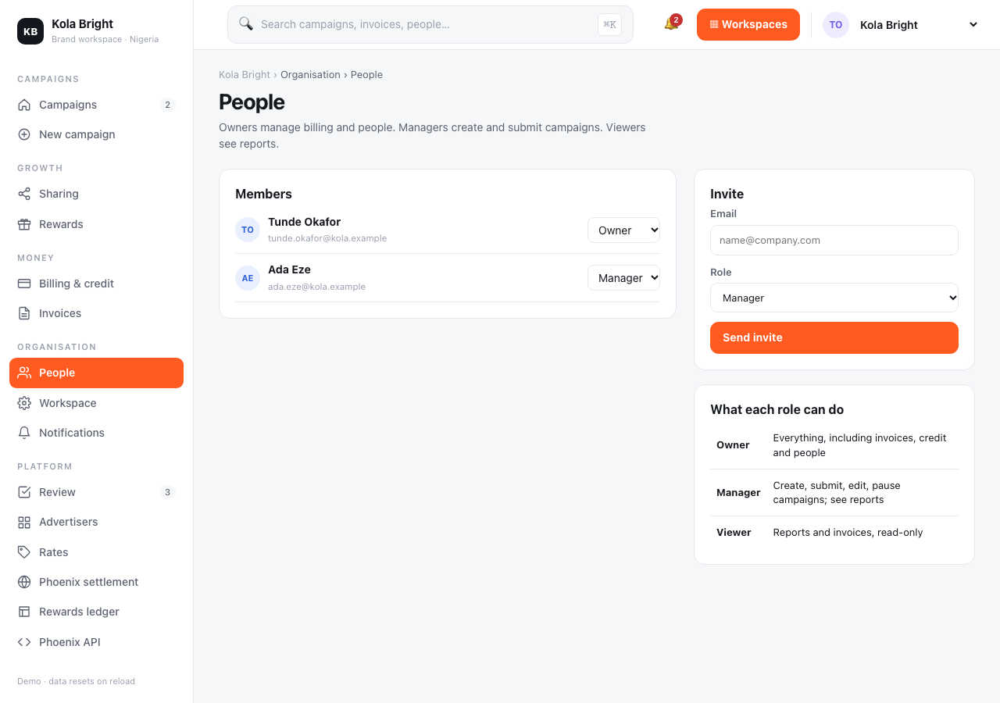
After an invite: [people-after-invite-1280.png](shots-advertiser/people-after-invite-1280.png)

- **PageHead:** crumb `Kola Bright › Organisation › People`; H1 `People`; lead `Owners manage billing and people. Managers create and submit campaigns. Viewers see reports.`
- **Left box `Members`**: a list; each row has
  - a 32 px blue-tint avatar with initials
  - the bold name and a grey email, generated as `firstname.lastname@{first word of workspace name, lowercased}.example` (`tunde.okafor@kola.example`, `dolapo.adeyemi@mediaspec.example`, `wanjiru.kamau@pesa.example`, `kofi.mensah@sunfresh.example`)
  - a **role select** (`Owner` / `Manager` / `Viewer`) preselected. **Changing it has no effect**: there is no handler, and it reverts on re-render.
  - Seed members: Kola: Tunde Okafor (Owner), Ada Eze (Manager). MediaSpec: Dolapo Adeyemi (Owner), Chidi Nwosu (Manager), Kemi Balogun (Viewer). Pesa: Wanjiru Kamau (Owner). SunFresh: Kofi Mensah (Owner).
- **Right box `Invite`**:
  - `Email` input, placeholder `name@company.com`
  - `Role` select `Manager` (default) / `Viewer` / `Owner`
  - `Send invite` (orange)
  - An empty or invalid email (fails `^\S+@\S+\.\S+$`) → toast `Enter a valid email`.
  - A valid email → the member is appended immediately with the **email as the name**, a one-letter avatar (e.g. `B`), the email again as the sub-line and the chosen role; toast `Invite sent`. There is no pending/invited state and no resend or revoke.
- **Right box `What each role can do`** (two-column table, no header):
  - **Owner**: `Everything, including invoices, credit and people`
  - **Manager**: `Create, submit, edit, pause campaigns; see reports`
  - **Viewer**: `Reports and invoices, read-only`
  - None of these permissions is enforced anywhere in the prototype.

---

## 10. Workspace

Nav: ORGANISATION › Workspace.

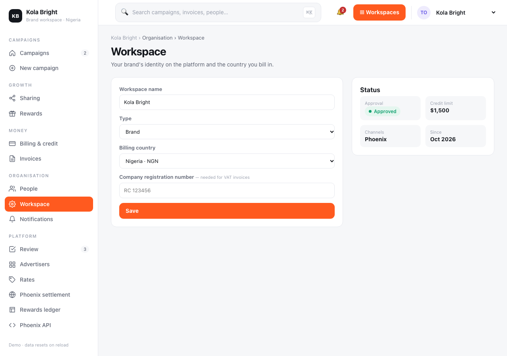
Agency: [workspace-agency-1280.png](shots-advertiser/workspace-agency-1280.png)

- **PageHead:** crumb `Kola Bright › Organisation › Workspace`; H1 `Workspace`; lead `Your brand's identity on the platform and the country you bill in.`
- **Left box (form)**:
  - `Workspace name` (text, prefilled)
  - `Type` select `Brand` / `Agency` (prefilled)
  - `Billing country` select with options `Nigeria · NGN`, `Kenya · KES`, `Ghana · GHS`, `Tanzania · TZS`, `Senegal · XOF`
  - `Company registration number` with hint `— needed for VAT invoices`, placeholder `RC 123456`
  - `Save` (orange) → toast `Saved`. **Nothing is persisted**: the name, type and country stay unchanged in the sidebar and elsewhere.
- **Right box `Status`** (`KVGrid`):
  - `Approval`: `StatusBadge` `Approved` (green) or `Pending approval` (amber)
  - `Credit limit`, e.g. `$1,500`
  - `Channels` `Phoenix`
  - `Since` `Oct 2026` (hard-coded)
- **Agency only, right box `Client workspaces`**: sub `Each client gets its own workspace with your team added.` Button `+ Add client brand` (white) **does nothing**.

---

## 11. Notifications (settings page)

Nav: ORGANISATION › Notifications.

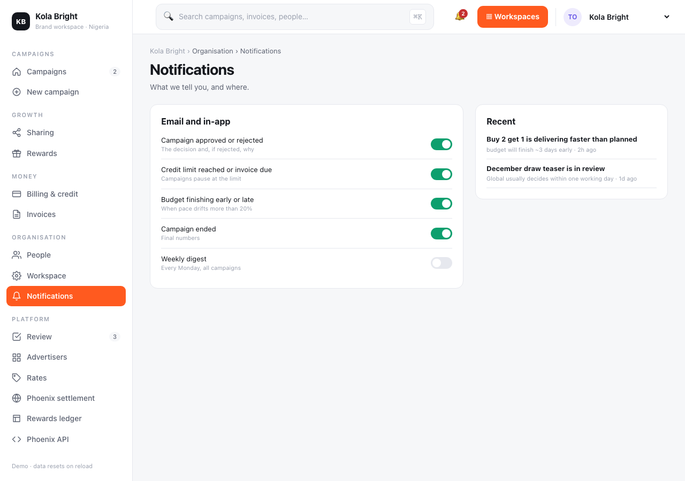
MediaSpec (different defaults): [notifications-mediaspec-1280.png](shots-advertiser/notifications-mediaspec-1280.png)

- **PageHead:** crumb `Kola Bright › Organisation › Notifications`; H1 `Notifications`; lead `What we tell you, and where.`
- **Left box `Email and in-app`**: five `ToggleRow`s, each with a label, a grey sub-line and a switch (`role="switch"`, `aria-checked`; green when on). Clicking flips it, with no toast. The value is stored per workspace in memory and survives navigation.
  | key | Label | Sub-line | Kola | MediaSpec | Pesa | SunFresh |
  |---|---|---|---|---|---|---|
  | approved | `Campaign approved or rejected` | `The decision and, if rejected, why` | on | on | on | on |
  | credit | `Credit limit reached or invoice due` | `Campaigns pause at the limit` | on | on | on | on |
  | pace | `Budget finishing early or late` | `When pace drifts more than 20%` | on | **off** | on | on |
  | ended | `Campaign ended` | `Final numbers` | on | on | on | on |
  | weekly | `Weekly digest` | `Every Monday, all campaigns` | **off** | **on** | off | off |
  - A single toggle covers both email and in-app; there is no per-channel choice.
  - The toggles do not filter what appears in the bell.
- **Right box `Recent`**: the same items as the bell, each a bold title plus a grey `{detail} · {age}`, separated by rules.

---

## 12. Bell panel

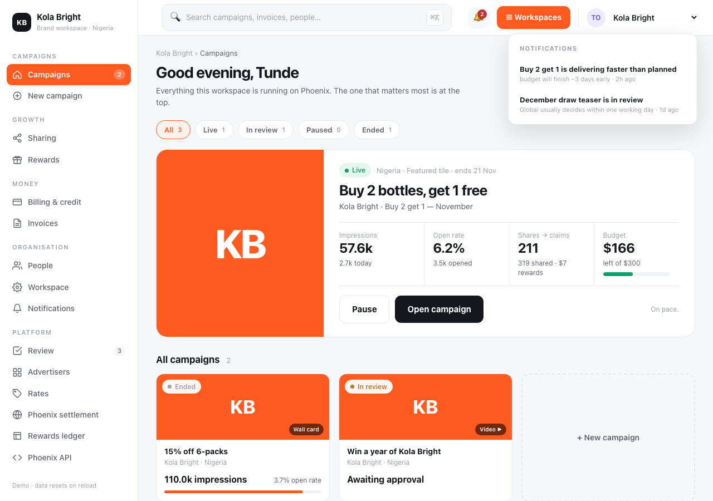

- Clicking the bell toggles a dropdown panel (340 px, absolute under the topbar's right side, rounded, shadowed).
- Header `NOTIFICATIONS` (11 px uppercase grey). Each item is a bold title plus a small grey `{detail} · {age}`, with a hover tint. Items are **not clickable**.
- If the detail is empty the line starts with ` · ` (e.g. ` · 3h ago`), which is a prototype bug.
- Empty state: `Nothing new.` (never reachable with seed data).
- Clicking anywhere outside closes it; clicking the bell again closes it.
- The count bubble equals the number of items. **There is no read/unread state**: opening the panel does not clear the count.
- Seed items:
  - Kola: `Buy 2 get 1 is delivering faster than planned` / `budget will finish ~3 days early` / `2h ago`; `December draw teaser is in review` / `Global usually decides within one working day` / `1d ago`
  - MediaSpec: `Weekend cashback — Tanzania is in review` / (empty) / `3h ago`; `INV-0044 is due in 5 days` / `$3,610 · pay by bank transfer` / `1d ago`; `Supa10 Jackpot: 1,000th share reward paid` / `KSh 10 airtime each` / `2d ago`
  - Pesa: `INV-0046 is overdue` / `campaigns pause if unpaid by 15 Nov` / `9d ago`
  - SunFresh: `Your workspace is awaiting approval` / `Global checks new advertisers within one working day` / `6h ago`
- Generated items (prepended, age `now`):
  | Trigger | Title | Detail |
  |---|---|---|
  | Submit | `{name} is in review` | `Global usually decides within one working day` |
  | Global approves (start ≤ now) | `{name} is live on Phoenix` | (empty) |
  | Global approves (future start) | `{name} is scheduled for {d Mon}` | (empty) |
  | Global rejects | `{name} was not approved` | `{reason}` |
  | Global approves workspace | `Your workspace is approved` | `Submit campaigns any time` |
  | Global changes credit limit | `Your credit limit is now {usd}` | (empty) |
  | Simulate: budget exhausted / end reached | `{name} ended` | `{fmt(imp)} impressions · {open rate} open rate` (or `budget fully delivered` if it was already out of budget) |
  | Simulate: over credit | `{name} paused — credit limit reached` | `pay an open invoice or ask Global to raise the limit` |
- At 390 the panel is pinned 10 px from the right edge: [bell-open-390.png](shots-advertiser/bell-open-390.png).

---

## 13. Search / ⌘K

- The topbar search is a **static `<div>`**: the 🔍 emoji, the placeholder-styled text `Search campaigns, invoices, people…` and a `⌘K` key-cap. It has no input, no click handler and no keyboard shortcut; in testing, ⌘K and Ctrl+K did nothing and the DOM was unchanged. The cursor stays the default arrow.
- It is hidden entirely at ≤980 px.
- **There is no command palette in the prototype.** Its behaviour is an open question.

---

## 14. Workspace switcher and what changes per workspace

**Mechanics.**
- The native `<select>` in the topbar lists `Kola Bright`, `MediaSpec (agency)`, `Pesa Link`, `SunFresh Juices` and `Platform (Global)`. Choosing a workspace sets it as current and navigates to **Campaigns home**.
  - The home **filter is not reset** (it is global state).
  - A pending **Edit offer draft also survives the switch** (see Open questions).
- Choosing `Platform (Global)` enters Platform mode: the sidebar shows only the PLATFORM group, the banner appears and the Review page opens. That is covered in the other inventory.
- The `▦ Workspaces` button only focuses this select and shows a toast. It does not open a list.

**Per-workspace differences** (everything else is identical):

| | Kola Bright | MediaSpec (agency) | Pesa Link | SunFresh Juices |
|---|---|---|---|---|
| Type / country / currency | Brand · Nigeria · NGN | **Agency** · Nigeria · NGN | Brand · Kenya · KES | Brand · Ghana · GHS |
| Status | Approved | Approved | Approved | **Pending approval** (banner shown) |
| Credit limit | $1,500 | $8,000 | $500 | $500 |
| Logo / avatar / greeting | KB / TO / Tunde | M( / DA / Dolapo | PL / WK / Wanjiru | SJ / KM / Kofi |
| Nav badges | Campaigns 2 | Campaigns 4, **Invoices 1** | Campaigns 1, **Invoices 1** | none |
| Bell count | 2 | 3 | 1 | 1 |
| Campaigns | 3 (live, ended, in review) | 5 brands: 777Bet, Pariez Cash, 777Bet Metro, Kwik Bank, Jackpot 10 (2 live, 1 in review, 1 paused, 1 ended); multi-country (KE, SN, TZ, NG) | 1 (live) | 0 → empty state |
| New campaign form | Brand readonly "Kola Bright" | **Brand editable, hint "— client", empty**; country default Nigeria | Brand readonly; CPMs in Kenya rates; reward in KES; default $300 **exceeds available credit** | Brand readonly; Ghana rates; GHS |
| Workspace page | Status box | Status box + **Client workspaces** box | Status box | `Pending approval` badge |
| Home | [home-default-1280](shots-advertiser/home-default-1280.png) | [home-mediaspec-1280](shots-advertiser/home-mediaspec-1280.png) | [home-pesa-1280](shots-advertiser/home-pesa-1280.png) | [home-sunfresh-1280](shots-advertiser/home-sunfresh-1280.png) |

**Agency model as built:**
- MediaSpec is **one** workspace that holds campaigns for many client brands. "Brand" is a free-text field on each campaign, and the campaigns can run in different countries.
- Billing, invoices, credit and people are shared across all those clients and kept in the agency's currency (NGN). Each campaign's reward is in its own country's currency.
- "Switching between client workspaces" therefore does not exist yet. The only hint of it is the Workspace page's "Client workspaces" box with a no-op `+ Add client brand`. See Open questions.

**Pending workspace (SunFresh):**
- The banner is shown on every page.
- The advertiser can still build and submit campaigns. They go to review, where Global sees `Workspace not yet approved — approve it first.` and the Approve button is disabled.
- After Global approves the workspace, the banner disappears and the notification `Your workspace is approved` / `Submit campaigns any time` appears.

---

## 15. Simulate a day

A `Simulate a day` button (white) appears in the head of **Campaigns home** and **Sharing** (and on Platform › Review). Clicking it advances delivery by one simulated day for **every live campaign in every workspace**, then re-renders the current page and shows the toast `Simulated one day on Phoenix — delivery, shares, rewards and statements updated`. The calendar does **not** advance: "today" and days-left stay the same.

For each live campaign:
1. left = budget − spend. If left ≤ 0: status → ended; notification `{name} ended` / `budget fully delivered`; skip to the next campaign.
2. **day** = min(left, budget ÷ max(1, days left) × U(0.8, 1.3)), where U is a uniform random factor.
3. Derived from `day`:
   - impressions = day × 0.88 ÷ CPM × 1000
   - opens = impressions × open rate × U(0.85, 1.15)
   - claims = opens × 0.33
   - shares = opens × 0.09
   - friend opens = shares × 2.2
   - friend claims = friend opens × 0.3
   - reward USD = min(remaining reward cap, friend claims × reward ÷ FX)
4. All counters are incremented. spend += day × 0.88 + reward. The 14-day series shifts left and the new day's impressions become `today`. Channels grow by 62/14/16/8% of the new shares.
5. Statement rows are prepended, dated today: `{campaign name} — delivery` −(day × 0.88), and, if reward > $0.50, `{campaign name} — share rewards` −reward. Unbilled rises by the same amount that budget-remaining falls, so **credit in use stays the same**.
6. If spend ≥ budget − $0.01 or days left = 0: status → ended; notification `{name} ended` / `{imp} impressions · {open rate} open rate`.
7. If the workspace's credit in use > its limit and the campaign is still live: status → **paused**; notification `{name} paused — credit limit reached` / `pay an open invoice or ask Global to raise the limit`.

After the loop, scheduled campaigns whose start ≤ now become live.

Observed example (Kola, "Buy 2 get 1"):
- Before: spend $132 of $300, today 4.6k.
- After 1 day: spend $173, today **17.9k** impressions (much larger than the seeded daily values), pace note changed to "Delivering faster than planned — budget will finish early.", statement +2 rows.
- The campaign ended after 8 clicks (spend $300 of $300), with the notification `Buy 2 get 1 — November ended` / `130.5k impressions · 5.2% open rate`.
- [home-after-simulate-1280.png](shots-advertiser/home-after-simulate-1280.png)

---

## 16. Responsive behaviour at 390 px

There is a single breakpoint, `max-width: 980px`:
- **App grid becomes one column.** The **sidebar is no longer sticky**: it renders in full at the top of every page (brand block plus all five nav groups plus the footer, about 890 px tall). There is no hamburger or drawer, so the first screen of every page is the nav ([home-abovefold-390.png](shots-advertiser/home-abovefold-390.png)).
- **Topbar** follows the sidebar and becomes sticky (top: 0) once scrolled past it. Padding drops to 14 px and gaps to 8 px. **Search is hidden.** The bell, `▦ Workspaces` (wraps to two lines) and avatar + select remain ([home-content-scrolled-390.png](shots-advertiser/home-content-scrolled-390.png)).
- Page wrap padding is 18 px 14 px 40 px. Head actions wrap under or next to the title (`Simulate a day` / `+ New campaign` stack).
- **Hero** stacks: the art (min-height 200 px) sits above the body, and the **stats become 2×2**.
- Card grids and `MetricCard` grids collapse to one column.
- `.two`, `.two.eq` and the preview modal's grid become one column, so right-column boxes (Change without review, The offer, Card preview, Cost, How you pay, Invite, etc.) move **below** the left content.
- The **form** becomes one column; **placement options are 2×2**; Sharing's **steps are one column**.
- The bell panel is pinned 10 px from the right.

Overflow defects at 390:
- The campaign page's Sharing KPI grid is inline `repeat(4,1fr)`, so the document is 544 px wide ([campaign-live-390.png](shots-advertiser/campaign-live-390.png)).
- The Invoices table (448 px in a 362 px box) and the Sharing table (456 px) overflow horizontally.
- Home is 1 px too wide.

Full pages: [home-default-390](shots-advertiser/home-default-390.png), [campaign-live-390](shots-advertiser/campaign-live-390.png), [new-empty-390](shots-advertiser/new-empty-390.png), [billing-kola-390](shots-advertiser/billing-kola-390.png), [preview-modal-390](shots-advertiser/preview-modal-390.png), [bell-open-390](shots-advertiser/bell-open-390.png).

---

## Object model

This model is reconstructed from the prototype's state (`C`, `WS`, `MKT`, `RATES`, `PL`, `OPEN`) and from every field the screens show. Money is stored in **USD**. Local amounts are derived with a monthly FX rate.

### Campaign
| Field | Type | Seen as | Notes |
|---|---|---|---|
| `id` | int | (internal) | |
| `workspaceId` | ref Workspace | crumb | |
| `brand` | string | card sub-line, preview `{Brand} · Sponsored` | Readonly = workspace name for brands; free text for agencies |
| `name` | string | crumb, Sharing/Rewards tables, notifications, statement lines | "for you, not shown to consumers" |
| `market` | `NG`/`KE`/`GH`/`TZ`/`SN` | Country | Determines CPM, open-rate rates, reward currency and preview wall |
| `category` | one of 7 | The offer › Category | Betting triggers the licence rule and 18+ |
| `headline` (`title`) | string ≤ 48 | H1, card title, preview | |
| `description` (`desc`) | string ≤ 240 | The offer paragraph, review queue | Must contain a licence/approval number for betting/draws |
| `redeem` | `code` \| `link` | `Code in store` / `Link` | Drives "Claim codes" vs "Clicks to you" and the funnel label |
| `link` | https URL | review queue tag | Required when redeem = link |
| `color` | hex (7 presets) | cover when there is no image | |
| `image` (`img`) | asset or null | cover, preview | Optional for card/featured; required for video/splash |
| `video` | bool | `▶` on cards | = placement is video |
| `placement` (`pl`) | `card` (Wall card) / `featured` (Featured tile) / `video` (Video) / `splash` (Splash) | placement pill, The offer | One placement per campaign |
| `ageGated` (`age`) | bool | `18+` badge | Derived at submit: category Betting or headline /jackpot\|bet/i |
| `budget` | USD, min 50 | Budget, Spent "of" | Editable without review |
| `start`, `end` | dates | lead `7 Nov – 21 Nov`, "ends", "starts", days left | Form: start date + "Runs for" (7/14/30); end editable without review |
| `reward` | number, in market currency units | "A sharer earns ₦50 airtime…" | Editable without review (campaign page or Rewards page) |
| `rewardCap` | % (always 20) | "Capped at 20% of budget", Rewards › Cap | |
| `status` | see the state machine | `StatusBadge` | |
| `note` | string | rejection reason | Set by Global on reject |
| Metrics: `imp`, `opens`, `claims`, `shares`, `sOpens` (friend opens), `sClaims` (friend claims), `spend` (USD, delivery + rewards), `rewardPaid` (USD), `days[14]` (daily impressions, last = today), `ch{WhatsApp,X,Facebook,SMS}` (share counts), `sharers[5]` (masked msisdn, claims) | | Reports | Event-derived in the real build (impression, open, claim, share, share_open, share_claim) |

**Derived metrics**
- open rate = opens ÷ impressions
- cost per claim/click = spend ÷ claims
- viral coefficient = friend opens ÷ opens
- friend claim rate = friend claims ÷ friend opens
- budget left = budget − spend
- spend progress = spend ÷ budget
- pace = (spend ÷ budget) ÷ max(0.05, elapsed ÷ flight); bands < 0.8 slow, > 1.2 fast
- days left = ceil((end − now) ÷ 1 day)

**Status state machine**

```
            submit                     approve (start ≤ now)
 [form] ──────────────▶ review ───────────────────────────▶ live ◀──────────┐
                          │  approve (start > now)            │  ▲         │
                          ├──────────────▶ scheduled ─────────┘  │ resume  │ (simulate: start reached)
                          │  reject + reason                  │  │ (blocked if over credit)
                          └──────────────▶ rejected           ▼  │
                                                            paused
 live/paused ── End campaign now (confirm) ──▶ ended          ▲
 live ── simulate: budget spent or end date reached ──▶ ended │ simulate: credit in use > limit
 live ── Pause ──▶ paused ─────────────────────────────────────┘
 any status ── Edit offer and resubmit ──▶ review   (including live, ended, rejected, scheduled)
```

Status labels and badge colours:
- `live` "Live" (green)
- `review` "In review" (amber)
- `scheduled` "Scheduled" (blue)
- `paused` "Paused" (amber)
- `rejected` "Rejected" (red)
- `ended` "Ended" (grey)
- `draft` (grey) exists in CSS, used only for the form's preview object.

### Workspace
| Field | Values | Notes |
|---|---|---|
| `id`, `name` | e.g. "Kola Bright" | |
| `type` | `Brand` \| `Agency` | Agency: brand is free text on campaigns; the Workspace page shows "Client workspaces" |
| `market` (billing country) | NG/KE/GH/TZ/SN | Sets the billing currency and FX |
| `creditLimit` | USD (Kola 1,500; MediaSpec 8,000; Pesa 500; SunFresh 500 "default credit $500") | Set by Global (Platform › Advertisers) |
| `status` | `approved` \| `pending` \| `declined` | Pending shows the banner; campaigns cannot be approved until the workspace is |
| `people[]` | {name, email, role} | Role ∈ Owner/Manager/Viewer; first member = Owner shown in the greeting and avatar |
| `invoices[]` | {number `INV-00xx`, period, amountUSD, status `paid`/`due`/`overdue`/`issued`, dueDate} | Monthly; Net 14; the current month is an `issued` "(to date)" invoice whose amount is the running unbilled total |
| `ledger[]` (statement) | {date, description, amountUSD (− charge, + payment)} | Lines: `{campaign} — delivery`, `{campaign} — share rewards`, `{INV} paid` |
| `notifications[]` | {title, detail, age} | No read state |
| `notificationPrefs` | approved, credit, pace, ended, weekly (+ an unused `rejected` key, always true) | |
| Hard-coded display fields | Terms `Net 14`, Next invoice `1 Dec`, Account manager `Obinna A.`, Channels `Phoenix`, Since `Oct 2026` | Should become real fields |
| Form-only (not stored) | Company registration number (`RC 123456`) | "needed for VAT invoices" |

**Credit:**
- in use = outstanding invoices (due + overdue) + unbilled charges + Σ remaining budget of live/review/scheduled/paused campaigns
- available = limit − in use
- New budget (submit or edit increase) is blocked if it would exceed the limit.
- Resume is blocked while over the limit.
- The daily delivery job pauses live campaigns while over the limit.
- Paying an invoice releases credit.

### Person / role
`{name, email, role: Owner | Manager | Viewer}`. Intended permissions (copy only, not enforced):
- Owner: everything, including invoices, credit and people.
- Manager: create, submit, edit and pause campaigns; see reports.
- Viewer: reports and invoices, read-only.

Invites add a member immediately (no pending state).

### Invoice
`{number, period ("Oct 2026" | "Nov 2026 (to date)"), amountUSD, amountLocal (derived), status (Paid/Due/Overdue/Open), dueDate, pdf}`. Actions: PDF (no-op), Mark paid (demo).

### Rewards and points
- **Per campaign:** airtime value in local currency per *successful share*. A successful share = a friend opened via the sharer's token and then claimed. Paid by the aggregator **Reloadly** "within minutes".
- The USD cost comes out of the campaign budget, capped at 20% of budget.
- **Points:** 10 OfferGrid points per successful share, "redeemable when the loyalty layer launches" (no redemption UI).
- **Caps (UI only):** max 5 successful shares per sharer per day, max 20% of budget, 10 points per share.

### Sharing chain (as described in the copy and the preview)
1. A Phoenix user taps **Share** on an offer. OfferGrid mints a **token** `PHX-XXXX-XXX` (example `PHX-K4Q7-7A2`) tied to the device and phone number; OTP verification on the first share only.
2. The link goes out via WhatsApp / X / Facebook / SMS. The channel is tagged on the token.
3. The **friend** lands on the same offer with the token (`share_open`). If they take a claim code or click through, that is a `share_claim`. Opens alone earn nothing.
4. The **sharer** earns the campaign's airtime + 10 points. Capped per sharer per day and at 20% of budget.
5. **What the sharer sees:** Phoenix's offer card with Share (and, per the Platform API doc, a reward label such as "Earn KSh 10 airtime"). **What the friend sees:** the same offer page. Neither consumer screen exists in the advertiser prototype beyond the phone mock.
6. **Advertiser reporting:** shares, friend opens, friend claims, viral coefficient, rewards paid (USD and local), channel split, and the top 5 sharers as masked phone numbers.

### Markets, currencies and rates
| Code | Country | Currency | Symbol | FX (1 USD =) | Wall card | Featured tile | Video | Splash |
|---|---|---|---|---|---|---|---|---|
| NG | Nigeria | NGN | ₦ | 1,550 | $1.20 | $2.20 | $4.50 | $8.00 |
| KE | Kenya | KES | KSh | 129 | $1.50 | $2.80 | $5.50 | $9.00 |
| GH | Ghana | GHS | GH₵ | 15.5 | $1.30 | $2.40 | $4.80 | $8.00 |
| TZ | Tanzania | TZS | TSh | 2,600 | $1.20 | $2.20 | $4.20 | $7.50 |
| SN | Senegal | XOF | F | 610 | $1.40 | $2.60 | $5.00 | $8.50 |

- CPMs are in USD per 1,000 impressions and are editable by Global. Changes apply to new campaigns only, but the advertiser UI always shows the *current* rate for the campaign's market.
- Open-rate model per placement: card 3.6%, featured 5.5%, video 7%, splash 9%.
- Categories: Food & drink, Personal care, Banking & fintech, Telecom & data, Betting, Travel, Retail.
- Channels (Platform): Phoenix Browser (live), Boomplay (coming soon). Advertisers see "Channels: Phoenix".

### Seed campaigns
Dates are relative to 13 Nov 2026; metrics are randomised.

| # | Workspace | Brand | Name | Mkt | Category | Headline | Placement | Redeem / link | Budget | Reward | Flight | Status | Image / 18+ |
|---|---|---|---|---|---|---|---|---|---|---|---|---|---|
| 1 | Kola | Kola Bright | Buy 2 get 1 — November | NG | Food & drink | Buy 2 bottles, get 1 free | Featured tile | code | $300 | ₦50 | 7 Nov – 21 Nov | Live (48% delivered) | colour #FF5A1F / no |
| 2 | Kola | Kola Bright | August multipack 15% off | NG | Food & drink | 15% off 6-packs | Wall card | code | $150 | ₦0 | 14 Oct – 28 Oct | Ended | colour / no |
| 3 | Kola | Kola Bright | December draw teaser | NG | Food & drink | Win a year of Kola Bright | Video (no creative) | https://kolabright.example/draw | $400 | ₦100 | 16 Nov – 30 Nov | In review | colour / no |
| 4 | MediaSpec | 777Bet | Supa10 Jackpot — Kenya | KE | Betting | Supa10 Jackpot — KSh 5M kwa buku tu | Featured tile | https://777bet.co.ke | $800 | KSh10 | 8 Nov – 22 Nov | Live (46%) | image / 18+ |
| 5 | MediaSpec | Pariez Cash | Foot Gabal-Lena — Senegal | SN | Betting | Ton 1er pari 100% remboursé | Wall card | https://pariezcash.com | $450 | F100 | 9 Nov – 2 Dec | Live (30%) | image / 18+ |
| 6 | MediaSpec | 777Bet Metro | Weekend cashback — Tanzania | TZ | Betting | Pata 10% ya mikeka uliyopoteza | Splash | https://777bet.tz | $600 | TSh500 | 14 Nov – 28 Nov | In review | image / 18+ |
| 7 | MediaSpec | Kwik Bank | Kwik ₦1m draw | NG | Banking & fintech | Deposit ₦5,000, enter the ₦1m draw | Wall card | https://kwik.example | $600 | ₦50 | 9 Nov – 9 Dec | Paused (30%) | colour #2B5FD9 / no |
| 8 | MediaSpec | Jackpot 10 | Jackpot 10 — Guinea-Bissau | SN | Betting | O Jackpot 10 está de volta | Wall card | https://jackpot10.example | $200 | F100 | 24 Oct – 11 Nov | Ended | image / 18+ |
| 9 | Pesa | Pesa Link | KSh 50 cashback on first top-up | KE | Banking & fintech | KSh 50 cashback on first airtime top-up | Wall card | https://pesalink.example | $150 | KSh5 | 8 Nov – 22 Nov | Live (60%) | colour / no |

Descriptions (verbatim):
1. `Buy any two 50cl Kola Bright at a participating store and get a third free. Show your claim code at the till.`
2. `At Shoprite and Justrite outlets nationwide.`
3. `Enter the December draw with any purchase. NLRC approval no. 2026/0413.`
4. `Predict 10 matches for KSh 100 and win a share of KSh 5,000,000. Draws every weekend. 18+. BCLB licence 0000123.`
5. `Premier pari gagnant ou remboursé en freebet jusqu'à 2 000 F sur le sport et le virtuel. Du 07 au 30 novembre. 18+. Licence LONASE 2026-118.`
6. `Weka dau wikiendi hii. Ukikosa, unarudishiwa 10% ya mikeka yako Jumatatu. 18+. GBT licence TZ-0921.`
7. `Fund your Kwik account with ₦5,000 or more this month and you are automatically entered.`
8. `Adivinhe os resultados para tentar ganhar a sua parte nos 2.000.000 FCFA. Bilhete por 200 FCFA. 18+.`
9. `Top up any network from Pesa Link and get KSh 50 back within 24 hours.`

### Seed generator
This is for building realistic fixtures, not for production. For a campaign with progress `p`:
- delivered = budget × p × 0.88
- imp = delivered ÷ CPM × 1000
- opens = imp × openRate × U(0.85, 1.15)
- claims = 0.33 × opens
- shares = 0.09 × opens
- sOpens = 2.2 × shares
- sClaims = 0.3 × sOpens
- rewardPaid = min(budget × 20%, sClaims × reward ÷ FX)
- spend = delivered + rewardPaid
- The 14 daily values are random weights × imp, so a campaign that started 6 days ago still shows 14 days of bars.
- Channels: WhatsApp 62%, X 14%, Facebook 16%, SMS 8%.
- Top sharers: 18/11/8/6/5% of sClaims, using the fixed masked numbers above.

---

## Flows

### F1. Create a campaign and submit it for review
1. Click `+ New campaign` (home head, dashed tile, or nav › New campaign).
2. The form opens with defaults: Country = workspace country, Category Food & drink, colour orange, Wall card, redeem "Send them to our site / app", Budget 300, 14 days, start tomorrow, reward 50. The hint reads `Give the campaign a name.`; `Submit for review` is disabled. The Card preview and Cost update on every keystroke.
3. Enter the Campaign name (and, for an agency, the client Brand), the headline (counter `n/48`) and the description.
4. Choose a placement. The CPM tile highlights and the cost recalculates. Video or splash requires `Upload creative`.
5. Choose the redeem method. `Claim code shown in store` disables Link. Otherwise enter an `https://` link.
6. Set the budget (≥ $50, within available credit), the duration (7/14/30 days), the start date and the share reward (local currency).
7. Optional: `See it on Phoenix` shows the card on a mock Phoenix wall.
8. Tick `This offer is genuine…`. The hint clears and Submit is enabled.
9. Click `Submit for review` → toast `Submitted — Global reviews within one working day`. The app lands on the campaign page: badge `In review`, `Global usually decides within one working day`, chart sub `Starts once approved.`, all zeros. The bell gains `{name} is in review`. The home count and `In review` pill go up by 1, and the card shows `Awaiting approval`.

### F2. What the advertiser sees while in review, after approval, and after rejection
- **In review:**
  - Home card: `In review` badge, `Awaiting approval`.
  - Hero (if there is no live or paused campaign): eyebrow `… · awaiting approval`, note `Global reviews within one working day.`
  - Campaign page as above.
  - The budget, end date and reward can still be changed without review. `Edit offer and resubmit` is available.
  - Credit already counts the full budget as "in use".
- **Approved** (Global, Platform › Review › Approve; toast there `Approved — advertiser emailed`):
  - If the start date ≤ now → `Live`, with the notification `{name} is live on Phoenix`.
  - If the start is in the future → `Scheduled` (blue badge), with `{name} is scheduled for 16 Nov`. Card main line `Starts 16 Nov`; campaign page chart sub `Scheduled.`; hero eyebrow `starts 16 Nov` (only if nothing is live, paused or in review). It becomes Live automatically on the next "Simulate a day" after the start date.
- **Rejected** (Global enters a reason in a native prompt, `Reason sent to the advertiser:`, default `Terms unclear — say where the offer can be redeemed.`; toast there `Rejected — advertiser emailed with the reason`):
  - Status `Rejected` (red). The card shows `Not approved` plus the reason.
  - The campaign page shows the red reason next to the badge; `Save changes` is disabled.
  - The notification is `{name} was not approved` / `{reason}`.
  - There is no Rejected filter pill.
  - **Recovery:** `Edit offer and resubmit` → fix → tick terms → `Save and resubmit` → `In review` again (toast `Resubmitted — Global reviews within one working day`).
  - The rejected campaign's budget no longer counts toward credit.

### F3. Pause, resume, end
1. **Pause** (hero or campaign head, live only) → `Paused`; toast `Paused — leaves Phoenix within 15 minutes. Resume any time.` Hero note `Paused — not delivering. Resume any time.`; chart sub `Paused — not delivering.` The budget remainder still counts as credit in use.
2. **Resume** (paused only):
   - If credit in use > limit → toast `Can't resume — credit limit reached. Pay the open invoice or ask Global to raise the limit.`
   - Else → `Live`; toast `Resumed — back on Phoenix within 15 minutes.`
3. **End campaign now** (campaign page, live or paused) → native confirm `End now? Unspent budget is released from your credit.` → OK → `Ended`; toast `Ended — $218 released`. Save changes is disabled. The hero passes to the next eligible campaign. Ended campaigns can still be edited and resubmitted.
4. Campaigns also end automatically during "Simulate a day" when the budget is spent or the end date is reached. Notification `{name} ended` / `{imp} impressions · {open rate} open rate`.

### F4. Credit limit and paying (there is no "add funds")
1. Credit is post-paid. The advertiser cannot add funds; they **pay invoices by bank transfer** (Net 14, quoting the invoice number), and the prototype simulates payment with `Mark paid`.
2. Credit runs out when open invoices + unbilled + remaining budgets exceed the limit. This happens when Global lowers the limit, or when an invoice becomes due or overdue. Delivery alone does not move "in use".
3. While over the limit:
   - Billing shows `Available $0 · close to the limit` and the red **`Credit limit reached.`** box.
   - New campaigns and budget increases are blocked (`Over your credit limit…` / `That would exceed your credit limit of $300`).
   - Resume is blocked.
   - On the next delivery day each live campaign is **paused**, with the notification `{name} paused — credit limit reached` / `pay an open invoice or ask Global to raise the limit`.
4. Paying the overdue invoice (Invoices › `Mark paid`) → toast `INV-0046 marked paid (demo) — credit released`, a statement row `13 Nov · INV-0046 paid · $210`, and in use drops by $210 (Pesa: $372 → $162). Resume then works.
5. `Request a higher limit` on Billing only shows a toast. Global raises the limit in Platform › Advertisers, and the advertiser gets the notification `Your credit limit is now $X`.

Screens: [billing-credit-limit-reached-1280](shots-advertiser/billing-credit-limit-reached-1280.png), [home-resume-blocked-credit-1280](shots-advertiser/home-resume-blocked-credit-1280.png), [invoices-after-mark-paid-1280](shots-advertiser/invoices-after-mark-paid-1280.png).

### F5. Invite a person
1. People › Invite: type an email and choose a role (Manager default; Viewer; Owner) → `Send invite`.
2. Invalid → toast `Enter a valid email`.
3. Valid → toast `Invite sent`; the person appears at the bottom of Members immediately with the email as their name and the chosen role.
4. There is no acceptance step, invite email preview, pending badge, resend or removal. Changing an existing member's role in the select does nothing.

### F6. Agency switching between client brands / workspaces
1. As built: an agency user selects `MediaSpec (agency)` in the topbar select. Home lists all of the agency's client campaigns (777Bet, Pariez Cash, 777Bet Metro, Kwik Bank, Jackpot 10) together; each card shows its brand and country.
2. New campaigns ask for `Brand — client` as free text. Billing, invoices, people and notifications are shared by the whole agency.
3. Workspace › `Client workspaces`: `Each client gets its own workspace with your team added.` `+ Add client brand` is not implemented.
4. Switching to another workspace (e.g. a brand the agency's person also belongs to) uses the same select: home reloads for that workspace with its own greeting, owner avatar, logo, badges, bell, currency and credit. The home filter and any open Edit-offer draft carry over (bugs).

### F7. Change budget, end date or reward without review
Campaign page › Change without review → edit → `Save changes` → toast `Saved — live within 15 minutes, no review needed`. The rules are under §2. The share reward can also be changed inline on the Rewards page (toast `Reward updated — applies to new shares`).

### F8. Edit the offer (creative and copy) → re-review
Campaign page › `Edit offer and resubmit` → the form in Edit mode (`Edit offer`) → change anything → tick terms → `Save and resubmit` → status `In review`. In the prototype this happens immediately, even for a live campaign, which contradicts the copy "The current version keeps running until the new one is approved." `Cancel` returns to the campaign page unchanged.

### F9. Pending workspace (new advertiser)
SunFresh shows the `Awaiting approval` banner on every page, empty home (`Nothing on Phoenix yet`), no invoices (`No invoices yet.`) and no charges (`No charges yet.`). The advertiser can submit campaigns; Global must approve the workspace first (approve toast `SunFresh Juices approved — owner emailed`). Then the banner disappears and the notification `Your workspace is approved` / `Submit campaigns any time` arrives.

---

## Recurring components

These names are used consistently in this document. Visual tokens are in the other agent's design-system inventory.

| Component | Where | Anatomy and behaviour |
|---|---|---|
| `Sidebar` | all | Brand block (logo initials, name, "{type} workspace · {country}"); grouped nav with icons and count pills; active = orange fill; footer `Demo · data resets on reload` |
| `Topbar` | all | Search (static), Bell + count, `▦ Workspaces`, owner avatar + workspace `<select>` |
| `Banner` | pending workspace / platform | Peach strip, bold orange lead word, em-dash sentence |
| `PageHead` | all | Breadcrumb, H1, lead, right-aligned actions |
| `Button` variants | all | `primary` orange (`+ New campaign`, `Save changes`, `Submit for review`, `Resume`, `Send invite`, `Save`, `Mark paid`); `dark` ink (`Open campaign`, `← Campaigns`, `Close`); `secondary` white with border (`Simulate a day`, `Pause`, `See it on Phoenix`, `Invoices`, `Request a higher limit`, `PDF`, `Edit offer and resubmit`, `Cancel`); destructive text variant = secondary with red text (`End campaign now`); sizes `s` (table rows), default, `lg` (hero); disabled = 40% opacity |
| `FilterPills` | home (also Platform Rates) | Rounded pills with a count; pressed = peach + orange |
| `StatusBadge` | cards, hero, campaign page, invoices, workspace | Pill with a coloured dot: Live/Approved/Paid green; In review/Paused/Due/Pending approval amber; Scheduled/Open blue; Rejected/Overdue red; Ended grey |
| `HeroCampaignCard` | home | Art panel + eyebrow + headline + brand·name + 4-stat row + actions + pace note |
| `CampaignCard` | home, form preview (and Platform "Live now") | Cover with status/18+/placement overlays, headline, brand·country(·days left), main metric row, spend bar |
| `NewCampaignTile` | home | Dashed tile `+ New campaign` |
| `MetricCard` | campaign page, Sharing, Billing (and Platform) | Title + green dot, big value, thin orange progress line, grey sub-line (an optional `Open ›` link exists in code but is unused) |
| `Box` (panel) | everywhere | White card with optional H3 + grey sub-line |
| `BarChart14d` | campaign page | 14 bars, today orange, `-13d … today` labels, `<title>` tooltips |
| `Funnel` | campaign page | Label / orange bar / value rows |
| `HBarList` | campaign page (counts), Sharing (percentages) | Label / purple track bar / value |
| `Leaderboard` | campaign page | Rank circle, monospace masked phone, `{n} claims` |
| `KVGrid` | campaign page (The offer), Billing (How you pay), Workspace (Status) | 2-column grey tiles: small label + bold value |
| `EditPanel` | campaign page, Rewards caps, Workspace form, People invite | Stacked labelled inputs + full-width buttons |
| `DataTable` | Sharing, Rewards, Billing statement, Invoices, People roles | Grey header, row rules, optional clickable rows, inline inputs/buttons, single-row empty text |
| `Form` + `OptionTile` + `Swatches` + `DropZone` + `CharCounter` + inline hint | New campaign / Edit offer | 2-column grid; first-error hint beside the submit button |
| `EstimatePanel` | form Cost, Sharing Points issued | Grey panel, small label, big number, line items |
| `Steps` | Sharing | 3 numbered grey tiles |
| `TokenChip` | Sharing | Monospace grey inline chip (`PHX-K4Q7-7A2`, `share_claim`) |
| `ToggleRow` / `Switch` | Notifications | Label + sub-line + switch (`role="switch"`) |
| `MemberRow` | People | Avatar initials, name, email, role select |
| `NotifPanel` | Bell | Dropdown list, outside-click close |
| `PhonePreviewModal` | campaign page, form | Modal + phone mock of the Phoenix Offers wall |
| `AlertBox` | Billing | Red-bordered pink box with bold red lead |
| `EmptyState` | home | Centred H3 + line |
| `Toast` | global | Bottom-centre dark pill, 2.2 s |
| Native dialogs | End campaign (`confirm`), Global reject (`prompt`) | Should become real modals in the rebuild |

---

## Open questions

Things that could not be reached, are not implemented, or where the prototype contradicts itself. A rebuild needs a decision on each.

1. **Search / ⌘K palette.** Not implemented: a static div with no handler or shortcut. What it searches (campaigns, invoices, people per the placeholder), its result layout and keyboard behaviour are undefined.
2. **New campaign is one form, not a wizard.** The brief mentions wizard steps, but the prototype has none ("One form."). Confirm single-page is intended. There is no draft save; leaving the page loses input.
3. **Add funds and payment methods do not exist.** The only payment path is bank transfer against invoices. `Mark paid` is labelled "(demo)". Is there a real payment-confirmation flow (reconciliation by Global)? Is prepaid top-up ever wanted?
4. **`PDF` invoice button is a no-op.** The invoice document's content and layout are not specified.
5. **Workspace switcher** is a native `<select>`; the `▦ Workspaces` button only focuses it. Should the real switcher be a popover listing workspaces with type and country? Which workspaces a user sees depends on membership, which the prototype does not model (every user sees all four plus Platform).
6. **PLATFORM nav group is visible to advertisers.** This is a prototype convenience; it must be hidden for advertiser roles.
7. **Agency model.** Is an agency one workspace with free-text client brands (as built), or a parent with child client workspaces ("Client workspaces" / `+ Add client brand`, a no-op)? Billing currency vs multi-country campaigns for an agency (NGN billing, KES/XOF/TZS rewards) needs confirming.
8. **Roles are not enforced.** The role select on People has no handler, and Viewers and Managers can see and do everything. Invites have no pending/accepted state, email delivery, resend or remove.
9. **Workspace Save persists nothing.** The name, type, billing country and company registration number are not stored; changing the billing country or type has no defined consequences.
10. **Edit offer on a live campaign** sets the status to In review immediately, which contradicts "The current version keeps running until the new one is approved." Do we need a versioned "pending revision" alongside the live version?
11. **Caps on the Rewards page are decorative.** Not saved and not used; rewardCap is fixed at 20%. Should caps be per workspace, per campaign or platform-wide (the API doc says 5 rewards per sharer per day per campaign)?
12. **Notification preferences** toggle in memory but do not affect the bell. There is a single switch for "Email and in-app"; there is no per-channel choice and no email templates.
13. **Bell has no read/unread state**, and items are not clickable (they could deep-link to the campaign or invoice). Empty detail produces a stray ` · `.
14. **Credit-limit pause timing.** Lowering the limit or an invoice going overdue shows "Credit limit reached… Live campaigns pause" immediately, but live campaigns pause only on the next delivery day. When exactly should pausing happen? The Pesa notification says campaigns pause "if unpaid by 15 Nov"; what is the grace rule?
15. **"Unbilled this month"** is computed by matching "Nov" in the statement date; the statement says "Every charge this month" yet lists October rows. Statement scope (month selector? since last invoice?) is undefined.
16. **Scheduled and Rejected have no filter pill**; they appear only under All. Intended?
17. **Rejected campaign chart sub-line reads "Scheduled."** (falls through to the default). The intended copy is unknown.
18. **Seed data inconsistencies** (do not copy into fixtures blindly):
    - "Jackpot 10 — Guinea-Bissau" uses market Senegal.
    - The ended Jackpot 10 shows `Spent $216 of $200`, an overspend because rewards are added on top of 88% delivery.
    - Top sharers for every campaign mix +234/+254/+233 numbers regardless of country.
    - Ended campaigns show "X today" impressions and a full 14-day chart.
    - Kola's notification "delivering faster than planned" contradicts the hero's "On pace."
    - "Kwik ₦1m draw" has "draw" in its headline but no licence number.
19. **Logo initials for "MediaSpec (agency)" render as `M(`.** Initials should ignore punctuation and parenthetical suffixes.
20. **The home filter and the Edit-offer draft persist across workspace switches and navigation.** Abandoning an Edit then clicking New campaign (even in another workspace) reopens "Edit offer" for the old campaign. These are bugs; define the intended reset behaviour.
21. **Nav badges go stale** after inline actions (End now, Mark paid) until the next navigation.
22. **Preview fidelity.** Splash is shown as a featured tile, not full-screen; video shows no player; the wall's category chips are static. What should splash and video previews look like? What does the consumer-side claim/share screen look like (not in the prototype)?
23. **Creative upload** is a demo toggle that attaches a random sample. Real constraints (MP4 6–15 s < 2 MB; splash portrait < 2 MB; image square/landscape) are in the hints only.
24. **Date validation.** Start dates in the past are allowed, and an end date before the start is allowed (Change without review). "Runs for" only offers 7/14/30, so Edit falls back to 7 days for other lengths.
25. **"Simulate a day" is a demo control.** In production the equivalent is the event ingestion + daily billing job. Confirm it must not ship. Note that it runs for all workspaces and does not advance the date.
26. **Accessibility.** The modal has no Escape-to-close or focus trap; the search is not focusable; swatches only have `aria-label="colour"`; End and Reject use native dialogs.
27. **390 px layout.** There is no mobile nav (the whole sidebar stacks above the content), and the campaign page, Invoices and Sharing tables overflow horizontally. Mobile nav design is undefined.
28. **The `inventory TBC` badge overlaps the "Splash" title** at 1280 (it renders as "Spl…").
29. **Not reachable in the advertiser UI:** a declined workspace (status `declined` exists, but its advertiser view was not designed); the `Open ›` link on metric cards (in code, unused); the bell empty state `Nothing new.`

---

## Appendix: screenshot index

All are in `shots-advertiser/`. The numbers inside them are randomised per session.

| File | Screen / state |
|---|---|
| [home-default-1280.png](shots-advertiser/home-default-1280.png) | Campaigns home, Kola Bright, full page |
| [home-abovefold-1280.png](shots-advertiser/home-abovefold-1280.png) | Home, viewport only (above the fold) |
| [home-filter-review-1280.png](shots-advertiser/home-filter-review-1280.png) | Home, "In review" filter (no hero) |
| [home-hero-paused-1280.png](shots-advertiser/home-hero-paused-1280.png) | Hero after Pause (Resume button, toast) |
| [home-after-simulate-1280.png](shots-advertiser/home-after-simulate-1280.png) | After Simulate a day (toast, numbers changed) |
| [home-scheduled-rejected-1280.png](shots-advertiser/home-scheduled-rejected-1280.png) | Home with Scheduled and Rejected cards |
| [home-resume-blocked-credit-1280.png](shots-advertiser/home-resume-blocked-credit-1280.png) | Pesa paused by credit; Resume blocked toast |
| [home-mediaspec-1280.png](shots-advertiser/home-mediaspec-1280.png) | Agency home (images, 18+, multi-country) |
| [home-pesa-1280.png](shots-advertiser/home-pesa-1280.png) | Pesa Link home (single campaign) |
| [home-sunfresh-1280.png](shots-advertiser/home-sunfresh-1280.png) | Pending workspace: banner + empty state |
| [home-default-390.png](shots-advertiser/home-default-390.png) | Home at 390, full page |
| [home-abovefold-390.png](shots-advertiser/home-abovefold-390.png) | 390 first screen = stacked nav |
| [home-content-scrolled-390.png](shots-advertiser/home-content-scrolled-390.png) | 390 scrolled to content (sticky topbar) |
| [campaign-live-1280.png](shots-advertiser/campaign-live-1280.png) | Campaign page, Live (claim code) |
| [campaign-live-image-18plus-1280.png](shots-advertiser/campaign-live-image-18plus-1280.png) | Campaign page, Live, image creative, link ("Clicks to you") |
| [campaign-paused-1280.png](shots-advertiser/campaign-paused-1280.png) | Campaign page, Paused |
| [campaign-in-review-1280.png](shots-advertiser/campaign-in-review-1280.png) | Campaign page, In review (video) |
| [campaign-in-review-splash-1280.png](shots-advertiser/campaign-in-review-splash-1280.png) | Campaign page, In review (splash), viewport |
| [campaign-submitted-in-review-1280.png](shots-advertiser/campaign-submitted-in-review-1280.png) | Right after Submit (toast) |
| [campaign-scheduled-1280.png](shots-advertiser/campaign-scheduled-1280.png) | Campaign page, Scheduled |
| [campaign-rejected-1280.png](shots-advertiser/campaign-rejected-1280.png) | Campaign page, Rejected with reason |
| [campaign-ended-1280.png](shots-advertiser/campaign-ended-1280.png) | Campaign page, Ended (seed) |
| [campaign-ended-by-advertiser-1280.png](shots-advertiser/campaign-ended-by-advertiser-1280.png) | After End campaign now (toast) |
| [campaign-live-390.png](shots-advertiser/campaign-live-390.png) | Campaign page at 390 (overflow visible) |
| [new-empty-kola-1280.png](shots-advertiser/new-empty-kola-1280.png) | New campaign, empty (brand) |
| [new-filled-valid-1280.png](shots-advertiser/new-filled-valid-1280.png) | New campaign, valid, Submit enabled |
| [new-error-licence-1280.png](shots-advertiser/new-error-licence-1280.png) | Betting without licence → hint, 18+ preview |
| [new-video-needs-creative-1280.png](shots-advertiser/new-video-needs-creative-1280.png) | Video selected, creative required |
| [new-splash-creative-1280.png](shots-advertiser/new-splash-creative-1280.png) | Splash with creative attached |
| [new-agency-mediaspec-1280.png](shots-advertiser/new-agency-mediaspec-1280.png) | Agency form (Brand — client) |
| [new-sunfresh-pending-1280.png](shots-advertiser/new-sunfresh-pending-1280.png) | Form in pending workspace (Ghana rates, banner) |
| [new-edit-offer-1280.png](shots-advertiser/new-edit-offer-1280.png) | Edit offer mode |
| [new-empty-390.png](shots-advertiser/new-empty-390.png) | Form at 390 |
| [preview-modal-campaign-1280.png](shots-advertiser/preview-modal-campaign-1280.png) | Phoenix preview, featured, colour cover |
| [preview-modal-image-1280.png](shots-advertiser/preview-modal-image-1280.png) | Phoenix preview, image creative + other live tile |
| [preview-modal-from-form-1280.png](shots-advertiser/preview-modal-from-form-1280.png) | Phoenix preview from the form (wall card outlined) |
| [preview-modal-390.png](shots-advertiser/preview-modal-390.png) | Phoenix preview at 390 |
| [sharing-kola-1280.png](shots-advertiser/sharing-kola-1280.png) | Sharing |
| [rewards-kola-1280.png](shots-advertiser/rewards-kola-1280.png) | Rewards |
| [billing-kola-1280.png](shots-advertiser/billing-kola-1280.png) | Billing & credit |
| [billing-pesa-1280.png](shots-advertiser/billing-pesa-1280.png) | Billing, KES |
| [billing-sunfresh-empty-1280.png](shots-advertiser/billing-sunfresh-empty-1280.png) | Billing, no charges |
| [billing-credit-limit-reached-1280.png](shots-advertiser/billing-credit-limit-reached-1280.png) | Billing over limit (red alert) |
| [billing-kola-390.png](shots-advertiser/billing-kola-390.png) | Billing at 390 |
| [invoices-kola-1280.png](shots-advertiser/invoices-kola-1280.png) | Invoices (Paid, Open) |
| [invoices-mediaspec-due-1280.png](shots-advertiser/invoices-mediaspec-due-1280.png) | Invoices with Due + Mark paid |
| [invoices-pesa-overdue-1280.png](shots-advertiser/invoices-pesa-overdue-1280.png) | Invoices with Overdue |
| [invoices-after-mark-paid-1280.png](shots-advertiser/invoices-after-mark-paid-1280.png) | After Mark paid (toast) |
| [people-kola-1280.png](shots-advertiser/people-kola-1280.png) | People |
| [people-after-invite-1280.png](shots-advertiser/people-after-invite-1280.png) | After a successful invite |
| [workspace-kola-1280.png](shots-advertiser/workspace-kola-1280.png) | Workspace (brand) |
| [workspace-agency-1280.png](shots-advertiser/workspace-agency-1280.png) | Workspace (agency, Client workspaces box) |
| [notifications-kola-1280.png](shots-advertiser/notifications-kola-1280.png) | Notifications settings |
| [notifications-mediaspec-1280.png](shots-advertiser/notifications-mediaspec-1280.png) | Notifications, MediaSpec |
| [bell-open-1280.png](shots-advertiser/bell-open-1280.png) | Bell panel |
| [bell-open-390.png](shots-advertiser/bell-open-390.png) | Bell panel at 390 |
| [workspaces-button-toast-1280.png](shots-advertiser/workspaces-button-toast-1280.png) | `▦ Workspaces` click (focus + toast) |
